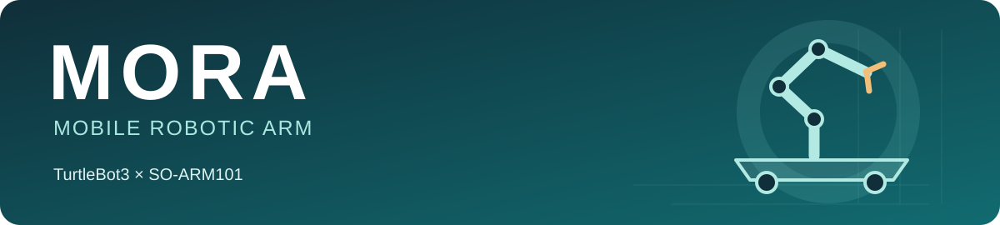
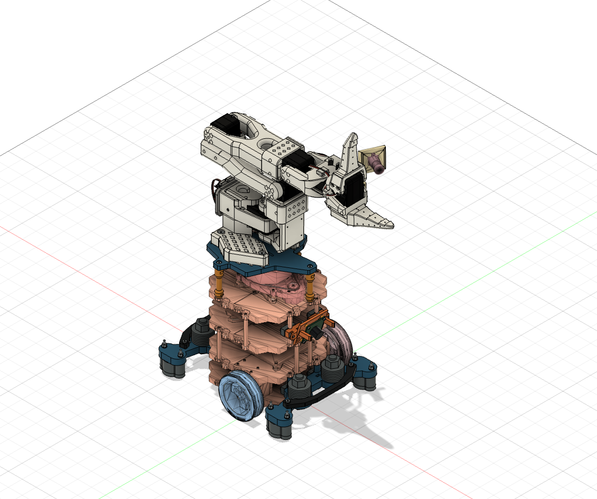
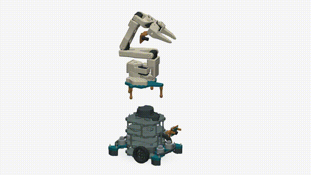
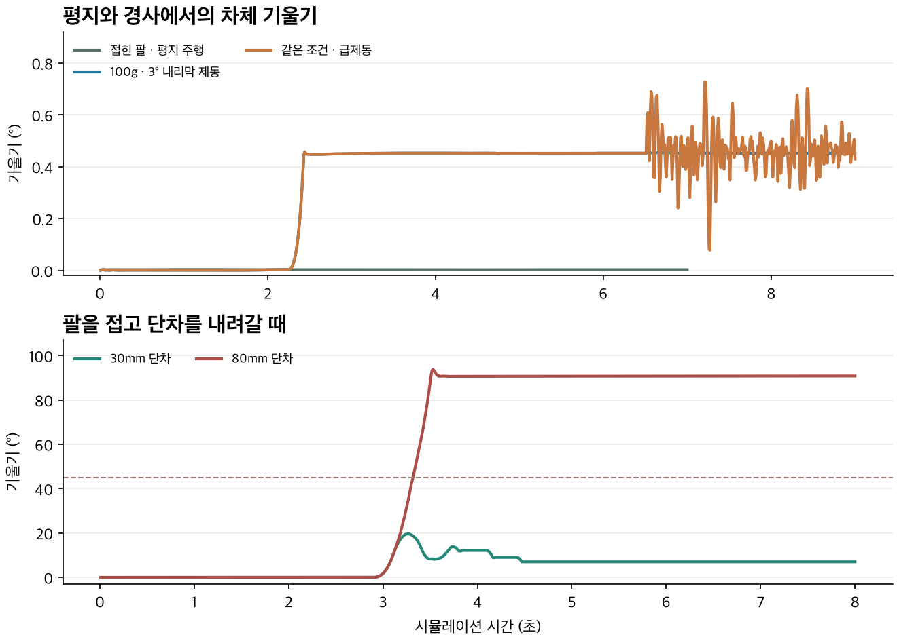
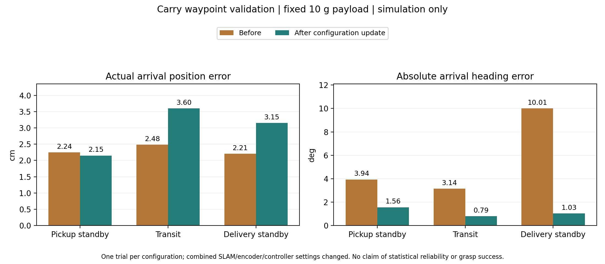
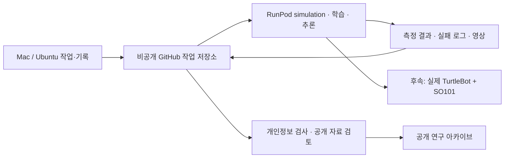

<div align="center">



**MORA · Mobile Robotic Arm**  
TurtleBot3 Burger × SO-ARM101 · 이동형 로봇팔의 파지와 운반을 연구합니다

CAD에서 물리 시뮬레이션, ROS 실험과 운반 연구까지




[자료 다운로드](https://github.com/jhyeong687/MORA/releases/tag/v0.1.0) · [CAD·애니메이션](docs/FUSION.md) · [검증 범위](docs/EVIDENCE.md) · [연구 계획](research/README.md) · [실행 환경](cloud/README.md) · [Mac ↔ Ubuntu](docs/SYNC.md)

</div>

## 이 프로젝트

**MORA**는 Mobile Robotic Arm에서 가져온 이름이다. `R4`는 현재 장착부의 설계 리비전이며, 기존 CAD·영상·보고서의 파일명과 실험 기록은 보존한다.

저가형 이동 베이스와 짧은 로봇 팔을 결합해 **접근 → 집기 → 확인 → 운반 → 놓기**를 연구한다.
상부 장착대, 체결부, 손목·belly 카메라, 교체형 출력 파트, 보조 지지 구조를 CAD로 구성했다.
설계 애니메이션, MuJoCo의 물리 시험, Ubuntu의 ROS/Gazebo 기록을 각각 증거와 연결해 보존한다.

> **현재 결과는 시뮬레이션이다.** 10 g 물체를 fixed joint로 부착한 운반은 접촉 파지 성공이 아니다.
> 실물 주행·안정 파지·VLA/WAM 성능 및 전복 안전성을 검증 완료했다고 주장하지 않는다.

## 먼저 볼 자료

| 보기 | 파일 |
| --- | --- |
| Fusion 조립 원본 | [R4 Final](cad/R4/TurtleBot3_SO101_R4_Final.f3d) / [Animation 원본](cad/R4/TurtleBot3_SO101_R4_Animated.f3d) |
| 출력·체결·구매 | [STEP](cad/R4/PRINT_R4_Mount.step), [12종 STL](cad/R4/STL), [조립·구매표](cad/R4/출력_구매_조립표.html) |
| 로봇만 나오는 영상 | [Fusion MP4](media/fusion/R4_Robot_Only.mp4), [3D 재생 HTML](cad/R4/R4_3D_Playback.html) |
| 물리 시험 | [MuJoCo 결과표](simulation/mujoco/results/scenarios.csv), [원본 조건](simulation/mujoco/results/cases.json) |
| ROS·Gazebo 기록 | [71쪽 기술 보고서](docs/ubuntu/R4_Engineering_Handoff.pdf), [텍스트](docs/ubuntu/REPORT.md), [trial registry](evidence/ubuntu/metadata/experiment_registry.json) |
| 다음 실험 | [20쪽 연구 계획](research/R4_Research_Plan_20261112.pdf), [가설·진행 순서](research/README.md) |

GitHub는 HTML을 직접 실행하지 않는다. 해당 폴더를 내려받아 브라우저에서 열면 된다.
Fusion native storyboard와 브라우저 playback은 서로 다른 자료이며 둘 다 보존한다.

<p align="center"><br/><sub>기존 Fusion/CAD 시각화의 일부 · 물리 검증 영상과 구분</sub></p>

## 실제 기록으로 본 현재 상태

| 항목 | 확인한 결과 | 남은 일 |
| --- | --- | --- |
| MuJoCo | 주행·제동·경사·단차·보조 지지·모터 근사 조사 | 실물 파라미터 식별과 반복 검증 |
| 80 mm 하강 단차 | 전도 관측, 시간 간격 교차검증 기록 | 단차 회피·실물 운용 범위 설정 |
| 팔 작은 범위 | 12/12 hold 구간 통과 | 전 작업공간·충돌·부하 검증 |
| 접촉 파지 | 일시 상승 뒤 낙하 | 반복 hold와 release |
| fixed fixture carry | 보정 후 단일 trial, waypoint 3/3 | 자유 물체 운반과 반복 평가 |
| 보정 후 도착 오차 | 위치 2.151/3.601/3.150 cm | 위치가 일부 증가한 조건도 포함해 재평가 |
| 실물·학습 정책 | 후속 단계 | 센서/관절 보정, cloud 추론, sim-to-real |

모든 trial을 같은 엔진·물성으로 합산하지 않는다. 실패와 중단 기록을 보존한다.
자세한 지표 정의와 경계는 [검증 문서](docs/EVIDENCE.md)에 있다.

<table><tr>
<td width="50%"><br/><b>물리 시험</b> · 전도가 발생하는 조건도 확인</td>
<td width="50%"><br/><b>ROS 운반 기록</b> · 위치와 방향 오차를 분리</td>
</tr></table>

## 연구 방향: 베이스가 파지 판단을 바꾸는가

**같은 파지라도 터틀봇이 다음 회전·정지를 하면 물체를 유지할 수 있는가?**

현재 영상과 관절 상태에 앞으로의 주행 계획을 함께 주고, 계속 운반·추가 확인·감속·재파지를 선택한다.
동일 reset recipe에 직진/좌·우회전/감속을 교차 적용하고, 항상 천천히 가는 기준과도 비교한다.
WAM은 미래 위험 예측의 확장, LLM은 검증된 skill 조합의 상위 비교로 둔다.
CheckVLA·DreamTrajectory·RoboJev 등 가까운 선행연구와의 차이를 [계획서](research/R4_Research_Plan_20261112.pdf)에 명시했다.



## 빠르게 확인

```bash
python3 scripts/mora.py doctor
python3 scripts/mora.py verify
python3 scripts/run_mujoco.py --list
```

위 세 명령은 무거운 시뮬레이션을 시작하지 않는다. 실험 실행은 [cloud 안내](cloud/README.md)를 따른다.
Mac과 Ubuntu에서 같은 `mora.py` 명령으로 작업·기록·동기화한다. 공개 반영은 [별도 export](docs/SYNC.md)를 사용한다.

## 폴더

```text
cad/R4/              Fusion / STEP / STL / 구매·조립표
media/               Fusion·MuJoCo·Ubuntu의 기존 영상
simulation/mujoco/   모델·제어·조건·원시 결과
simulation/gazebo/   ROS 2 / Gazebo current source
evidence/ubuntu/     registry·선별 metrics·그림
research/            후속 연구 계획·문헌·protocol
scripts/             두 OS 공통 점검·기록·동기화·공개 export
cloud/               RunPod 재현·메모리·전송 경계
metadata/            파일 hash와 검토한 binary 목록
```

## 출처와 개인정보

원 로봇 자산과 license는 [출처 문서](THIRD_PARTY_NOTICES.md)에 명시했다.
개인 홈 경로·실명·개인 문서 접근 링크·인증 파일을 제외한 사본이다.
PDF 텍스트 redaction, 영상·대표 이미지 검토와 binary hash 검토를 수행했다.
기존 결과는 보존 자료이며 이 저장소를 만드는 과정에서 새 GPU 작업을 실행한 것은 아니다.
