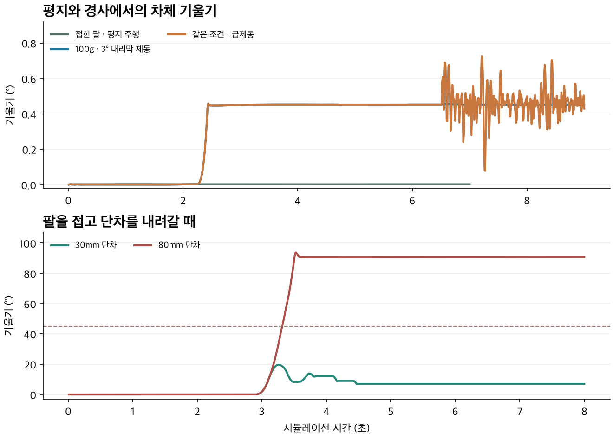

# macOS 설계·전복 안정성 테스트

터틀봇 위에 SO-ARM101을 장착했을 때 넘어지는 조건을 찾기 위해 남긴 **기존 CAD 계산·MuJoCo 시험·출력 검토**다. 새 실험을 돌린 보고서가 아니라 저장된 원본 결과를 정리한 문서다.

[영상 7개 바로 보기](../media/README.md#stability) · [전체 조건 CSV](../simulation/mujoco/results/scenarios.csv) · [조건 정의 JSON](../simulation/mujoco/results/cases.json)

## 무엇을 확인했나

| 질문 | 남긴 기록 |
| --- | --- |
| 주행·급정지·회전 때 기울어지는가? | 차체 기울기, 바퀴 접촉·들림, 속도·제동 거리 |
| 팔을 뻗고 100 g을 달면 어떻게 되는가? | 차체 기울기, 보조 지지 하중, 팔 토크와 관절 오차 |
| 경사·턱·하강 단차에서는? | 3° 경사, 10/20 mm 턱, 30/80/120 mm 하강 단차 |
| 보조 강구를 없애면? | 강구만 해제한 경우와 강구·하우징 모두 해제한 경우를 분리 |
| 모터·마찰·중심 위치 가정에 민감한가? | 모터 전압·정격 근사, 마찰·지지 간극·중심 변화, 시간 간격 교차검증 |

## 동적 시험: 57행의 조건별 결과

57행에는 서로 다른 운용 조건, 24개 파라미터 조합, 전도 검출용 양성 대조, 수치 시간 간격 검토가 섞여 있다. 독립 반복 57회나 안전 성공률로 세지 않는다.

`peak_deg`는 초기 0.5초를 제외한 차체 기울기의 최댓값이다. `tip45`는 이 구간에서 45° 이상이 한 번이라도 관측되었는지 나타내는 검출 기준이며, 45° 미만이라는 이유만으로 실물 안전·주행 성공을 뜻하지 않는다.

| 기존 조건 | 최대 기울기 | 45° 이상 검출 | 읽는 법 |
| --- | ---: | --- | --- |
| 평지 주행 (`flat_drive`) | 0.003° | 없음 | 모델 내 기본 주행 |
| 접힌 팔 급정지 (`stow_brake`) | 0.456° | 없음 | 제동 중 접촉 하중도 함께 확인 |
| 급회전 (`tight_turn`) | 0.374° | 없음 | 바퀴 하중·간극 기록을 함께 확인 |
| 100 g 부착·팔 뻗기 (`extend_100g`) | 0.457° | 없음 | 그리퍼 body에 질량을 부착한 조건 |
| 3° 경사·100 g 부착·급정지 (`downhill_estop`) | 0.726° | 없음 | 모터 정격 근사 초과 기록도 별도 확인 |
| 10 mm 위쪽 턱 (`step_10mm`) | 0.440° | 없음 | 턱·구조 접촉이 있어 미전도를 등반 성공으로 세지 않음 |
| 30 mm 하강 단차 (`edge_30mm`) | 19.578° | 없음 | 큰 기울기와 구동 바퀴 들림이 발생 |
| 80 mm 하강 단차 (`edge_80mm`) | 93.808° | 있음 | 전도 관측 |
| 120 mm 하강 단차 (`edge_120mm`) | 94.968° | 있음 | 전도 관측 |
| 보조 강구 접촉 해제 (`balls_disabled`) | 10.624° | 없음 | 하우징이 바닥에 닿아 지지할 수 있음 |
| 강구·하우징 접촉 모두 해제 (`balls_and_cups_disabled`) | 51.598° | 있음 | 45° 이상 검출; 완전한 지지 제거 조건으로 구분 |

**8 cm 하강 단차의 전도 영상**

https://github.com/user-attachments/assets/a3e8268b-6383-4e0e-ad34-fb09c7dd1501

## 수치 시간 간격 교차검증

같은 80 mm 하강 단차를 2 / 1 / 0.5 ms 시간 간격에서 확인한 기존 기록이다. 이 사례의 전도 검출이 반복된 것이며 모든 접촉 현상의 완전한 수치 수렴을 입증한 것은 아니다.

| 시간 간격 | 최대 기울기 | 45° 이상 검출 |
| --- | ---: | --- |
| 2 ms | 93.808° | 있음 |
| 1 ms | 93.855° | 있음 |
| 0.5 ms | 93.897° | 있음 |

## CAD 무게중심·지지 영역 계산

기존 정적 계산은 Sobol 팔 자세 후보 **65,536개**를 사용했고, 그중 접힌 주행 자세 표본은 **1,213개**였다. 실제 로봇을 이 횟수만큼 움직인 시험이 아니다.

아래 값은 계산된 지지 경계까지의 최소 여유(mm)다. 원래 3점 지지와 보조 강구가 지지한다고 가정한 영역을 비교한다. 음수는 해당 가정에서 경계 밖으로 나가는 조건이 있다는 뜻이다. 보조 강구가 실제로 항상 바닥에 닿는다는 보장은 포함하지 않는다.

| 계산 조건 | 원래 3점 지지, 불확실성 포함 | 보조 지지 가정, 불확실성 포함 |
| --- | ---: | ---: |
| 빈 집게·접힌 자세 / 경사 0.5° / 합성 가속·제동 0.15 m/s² | +6.83 mm | +53.72 mm |
| 50 g / 수평·정지 / 팔 전체 자세 표본 | -30.67 mm | +16.45 mm |
| 100 g / 수평·정지 / 팔 전체 자세 표본 | -37.37 mm | +10.05 mm |
| 100 g / 경사 3° / 합성 가속·제동 0.5 m/s² | -53.32 mm | -5.28 mm |

출력물 질량 ±30%, 차체 중심의 축별 오차, 팔 질량 원점 5 mm 오차, 부가 하드웨어 0–80 g, 손목 추가 질량·위치 오차 등을 둔 과거 계산이다. 특히 100 g·경사·가속 조건은 보조 지지를 가정해도 음수 여유가 남는다. 이 계산만으로 모든 팔 자세의 이동을 허용하지 않는다.

[정적 계산 원본 JSON](../evidence/design/R4_Static_Screening.json) · [조립·주행 검토표](../cad/R4/출력_구매_조립표.html)

## 3D 출력 설계 검토

R4 출력 부품 12종의 기존 슬라이싱 결과도 보존했다. 0.4 mm 노즐·0.2 mm 층, 외벽 5줄·상하 6층·55% gyroid 조건의 추정값이며 실제 출력·조립·강도 시험과 구분한다. PETG 부품과 TPU 범퍼를 구분하고, 카메라 브리지 등 지지재가 필요한 부품을 확인한다.

[12종 슬라이싱 결과 JSON](../evidence/design/R4_Print_Slicing.json) · [STL](../cad/R4/STL) · [설계 기록의 출처·해시](../metadata/design_evidence.json)

## 발표에서 설명할 결론

“무게중심 계산과 급정지·회전·경사·단차·보조 지지 제거 시뮬레이션으로 설계를 검토했다. 작은 기울기로 유지된 조건도 있었지만, 8 cm 하강 단차에서는 전도가 관측됐다. 그래서 팔 자세와 주행 조건을 제한하고, 실물 질량·마찰·모터·접촉을 측정해 다시 확인해야 한다.”

CAD 계산과 MuJoCo의 질량·접촉 근사는 서로 다르며 하나의 통합 안전 판정으로 합치지 않는다. 현재 결과는 물리 시뮬레이션과 설계 계산이다. 소켓 파손·프린트 강도·볼트 풀림·실제 로봇 전복 안전성은 실물 시험이 필요하다.
