# 01. 보고서의 목적과 최종 상태

이 문서는 R4 결합 로봇의 연구용 환경을 처음 구성한 기록부터 2026년 11월 12일의 운반 주행 보정까지를 정리한 기술 보고서이자, 다음 Codex가 실험 계획을 세우기 위한 인수인계 문서다. 대화의 설명만 재구성하지 않고 저장된 설정, 실제 측정 JSON, 소스 코드, Gazebo·RViz 사진을 서로 대조했다. 모든 수치는 별도로 명시하지 않는 한 시뮬레이션 결과다.

**현재 확인한 핵심은 ‘이미 물체를 든 상태의 SLAM waypoint 이동’이다.** 32 mm, 10 g 물체를 그리퍼에 fixed joint로 연결한 초기 조건에서 지도를 작성하고 세 지점으로 이동했다. 이 fixture는 물체를 계속 들고 있다는 조건을 만드는 장치다. 물리적 파지의 성공률을 측정한 것이 아니다.

보정 후 검증 시험 `carry_navigation_calibrated_01`은 세 지점 모두 사전 도착 기준을 통과했다. simulator truth 기준 위치 오차는 2.151 / 3.601 / 3.150 cm, 방향 오차는 -1.565 / +0.794 / +1.027°다. 조건별 한 번의 시험이므로 반복 신뢰성이나 실물 성능으로 일반화할 수 없다. 방향 오차는 이전보다 줄었지만 일부 지점의 위치 오차는 증가했다.

| 항목 | 확인 상태 | 해석의 경계 |
|---|---|---|
| Gazebo·ROS 2·SLAM·RViz 연결 | 실행·수신·화면 확인 | 실물 연결과 구분 |
| 엔코더 제어와 SLAM 피드백 비교 | 각 1회 완료 | 누적 오차의 무게 원인은 미분리 |
| 팔 6관절 작은 범위 추종 | 12/12 구간 통과 | 전 범위·자기충돌·파지 검증 아님 |
| RGB 큐브 위치 보정 | 알려진 크기·높이 조건에서 실행 | 일반 3D 물체 인식 아님 |
| 접촉 기반 파지 | 단일 상승 관측, 이후 실패 | 안정적인 반복 파지는 미해결 |
| 이미 든 물체의 운반 이동 | 보정 전·후 각각 3/3 지점 통과 | fixed fixture, 놓기 미시험 |
| 엔코더 유효 geometry | 독립 동작으로 식별·별도 경로 검증 | 시뮬레이션 전용 값 |
| 실물 TurtleBot | 연결 전 점검 도구·경계 문서 준비 | 실물 주행·정지·보정 미검증 |
| MolmoAct2 / HomeBody | 향후 참고 대상으로 기록 | 모델 설치·추론·학습 없음 |

보고서 제작 시점에 다시 조회한 결과 로봇 시뮬레이터·주행 제어기·녹화 프로세스는 실행 중이지 않았다. 이전 대화 말미에 “시각화만 켜 두었다”는 기록은 당시 상태다. PID는 과거 로그에 남아 있어도 다시 사용하지 않는다. 현재 파일과 아래의 최신 인수인계 안내를 과거 문서의 “진행 중” 문구보다 우선한다.

<figure>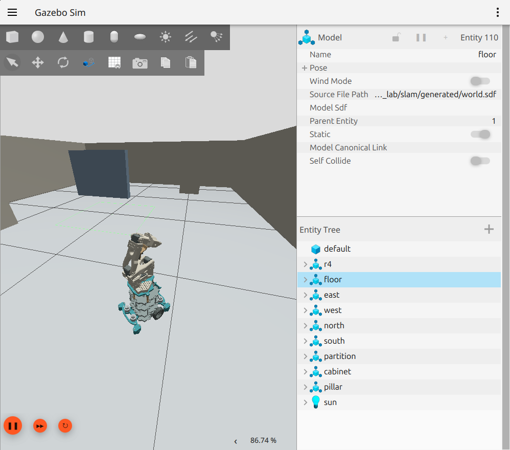<figcaption>그림 1. 불러온 TurtleBot3 계열 베이스와 SO-ARM101 팔의 결합 모델. 실제 Gazebo 창의 과거 캡처다. 실물 사operator 아니며, 현재 사용자의 고정 시점 선호가 정해지기 전 촬영된 장면이다.</figcaption></figure>

# 02. 사용자 요구와 작업 범위가 바뀐 과정

작업의 출발점은 “어제 r4_lab에서 하던 작업을 이어서, 옆에 시각화를 보면서 진행”하는 요청이었다. 이후 연구 자료에 쓸 사진·영상과 오류 원인 기록을 남기도록 요청했고, 자료는 모든 장면을 나열하기보다 핵심만 선별하는 방향으로 정리했다.

처음에는 지도 작성 → waypoint 이동 → 책상 위 물체 집기 → 다른 위치로 운반·놓기의 기본 환경을 만들었다. 사용자는 향후 MolmoAct2를 붙일 가능성이 높고 Caltech·Stanford HomeBody도 참고할 뜻을 밝혔으나, **당장은 논문 재현이나 모델 도입 대신 기본 환경의 기능 확인만 하도록 범위를 제한했다.**

물리 파지가 반복적으로 안정되지 않자 사용자는 “그냥 물건을 계속 잡고 있는 상태로 waypoint를 지정해서 거기까지 잘 가는지만”, “잡는 건 나중에 VLA로”라고 명시했다. 따라서 접촉 기반 파지의 추가 수정과 놓기 시험을 멈추고 carry 시나리오를 분리했다. 뒤이어 정식 실험 전 설정·오차를 보정하고, 나중의 실물 TurtleBot 실행을 고려하도록 요청했다.

| 순서 | 작업 | 결과 및 범위 결정 |
|---|---|---|
| 2026-11-11 | 초기 ROS/Gazebo/SLAM 구성 | 정지 수신·지도 저장까지 확인 |
| 11-12 초기 | 정지·25 cm smoke·1.2 m 경로 | 엔코더 누적 오차 발견 |
| 이어서 | 엔코더 vs SLAM map 제어 | 복귀 오차 차이를 측정 |
| 기본 조작 | 팔 개별 움직임·작업대/RGB 구성 | 작은 범위 팔 동작 통과 |
| 파지 시도 1~3 | 접촉·lift·운반 자세 | 단일 상승 후 낙하, 반복 파지 미해결 |
| 사용자 중지 | session_stop 보존 | 당시 지도·pose graph·자료 저장 |
| 사용자 재개 | 짧은 파지 bench | 잠시 상승 후 유지 실패 |
| 범위 축소 | 이미 든 상태의 carry 이동 | 파지·놓기는 제외 |
| 보정 | 회전 스캔, odom, QoS, TF, GUI | 독립 식별 후 carry 재검증 |
| 현재 요청 | 상세 PDF와 Codex 인수인계 | 새 실험 없이 저장 자료 문서화 |

중요한 사용 선호는 다음과 같다. 실험 중 Gazebo 카메라를 자동 추적하거나 임의로 옮기지 않는다. 사용자가 정한 줌·회전을 그대로 녹화한다. 설명에는 실제 완료, 실패, 가설, 미확인을 구분한다. 물체를 fixed joint로 들게 한 사실을 숨기거나 이를 파지 성공으로 기록하지 않는다. 실물 미측정 파라미터를 보정 완료라고 표현하지 않는다.

다음 Codex에게 전달할 자료는 이 PDF, `handoff/START_HERE.md`, `handoff/NEXT_CODEX_PROMPT.txt`, 기계 판독용 실험 목록 및 소스·설정·증거 묶음이다. 과거 중지 기록은 삭제하지 않되 최신 요구와 혼동하지 않도록 한다.

# 03. 실행 환경과 재현의 전제

현재 환경은 UTM 가상 머신 안의 Ubuntu 24.04.4 LTS, aarch64다. ROS 2 배포판은 Jazzy, Gazebo는 Harmonic 계열의 gz-sim8, 물리 엔진은 DART다. 커널과 패키지 버전은 보고서 생성 시 `metadata/environment.json`으로 별도 수집했다. 동일한 소스라도 다른 CPU·렌더러·스케줄링에서 완전히 동일한 궤적이 보장되는 것은 아니다.

| 구성 | 현재 확인 내용 |
|---|---|
| 작업 루트 | `/workspace/r4_lab` |
| ROS 설정 | `/opt/ros/jazzy/setup.bash` |
| bridge 패키지 | ros-jazzy-ros-gz-bridge 1.0.22 |
| SLAM 패키지 | ros-jazzy-slam-toolbox 2.8.4 |
| RViz | ros-jazzy-rviz2 14.1.20 |
| robot_state_publisher | 3.3.3 |
| 물리 step | 0.001 s |
| seed | 42 |
| 기본 초기 위치 | world (-1.2, -1.0, 0 rad) |
| 시뮬레이션 ROS domain | 46 |
| Gazebo partition | r4_slam |
| discovery | LOCALHOST, 시뮬레이션 전용 |
| GUI 환경 | GNOME/Xwayland, VM의 software rendering fallback 관측 |

`slam/env.sh`는 ROS와 시뮬레이션의 domain·partition·resource/plugin 경로를 설정한다. 경로의 일부는 스크립트 자신의 위치에서 구하도록 고쳤지만, 프로젝트에 있는 모든 과거 스크립트와 snapshot이 완전히 이동 가능해진 것은 아니다. 새 컴퓨터에서는 절대 경로를 검색하고 C++ plugin을 그 컴퓨터에서 다시 빌드해야 한다. 현재 바이너리는 aarch64용이며 다른 CPU용으로 보장하지 않는다.

`start_slam`은 설정과 원본 SDF를 읽어 `slam/generated/`를 생성하고 CMake로 모터 plugin을 빌드한 뒤 ROS launch를 실행한다. `generated/world.sdf`, `r4.urdf`, `resolved.json`, `slam.yaml`은 다음 시작에서 덮어써지는 산출물이다. 실험 결과 폴더 안의 configuration/source 사본과 혼동하지 않는다.

기본 의존성은 ROS bridge·slam_toolbox·robot_state_publisher·RViz·nav2 map saver, gz-sim8/transport13/plugin2 개발 구성, CMake/C++17, Python의 numpy/scipy/PyYAML/Pillow/PyQt5, GStreamer와 x264 encoder다. 모든 의존성을 새 머신에서 clean install하여 검증한 상태는 아니다. PDF 제작 도구는 `reports/pdf_deps`에 따로 설치해 로봇 실행 코드와 분리했다.

처음부터 다시 재현할 때에는 먼저 하드웨어가 연결되지 않은 시뮬레이션 domain인지 확인하고, 이미 실행 중인 월드·bridge·제어기가 없는지 조회한다. 과거 PID를 복사해 종료 명령에 사용하지 않는다. 프로세스 시작만으로 렌더링 성공을 판단하지 말고 실제 창 사진과 토픽·TF 수신을 함께 확인한다.

# 04. 원본 로봇과 생성 장면의 구조

원본은 `lab.sdf`, `R4/r4.xml`, `R4/engine.py`, `R4/assets/`다. Gazebo 연구 환경은 원본을 직접 덮어쓰지 않고 `prepare.py`에서 파생시킨다. `R4`에는 MuJoCo 계열 원본 정의와 mesh가 함께 있지만, 이번 검증의 실행기는 Gazebo/DART다. 두 엔진의 물성이 동일하다고 가정하지 않는다.

작업장에는 약 5 × 4 m 내부 영역을 둘러싼 벽과 partition, cabinet, pillar를 둔다. 실제 설정은 아래 표와 생성 SDF를 기준으로 한다. 표의 크기는 x/y/z 순서다.

| 물체 | 중심 [m] | 크기 [m] |
|---|---|---|
| east wall | (2.55, 0, 0.5) | (0.1, 4.2, 1.0) |
| west wall | (-2.55, 0, 0.5) | (0.1, 4.2, 1.0) |
| north wall | (0, 2.05, 0.5) | (5.2, 0.1, 1.0) |
| south wall | (0, -2.05, 0.5) | (5.2, 0.1, 1.0) |
| partition | (0.9, 0.65, 0.4) | (0.12, 1.1, 0.8) |
| cabinet | (-0.9, 1.2, 0.35) | (0.65, 0.45, 0.7) |
| pillar | (1.7, -1.0, 0.4) | (0.3, 0.4, 0.8) |

기본 모델 질량의 합은 2.722773669 kg다. 초기 zero-joint 형상의 model-frame 무게중심은 약 (-0.033587, 0.000349, 0.142371) m로 계산했다. 이는 모델의 링크 질량과 배치로 계산한 값이며 실물 저울 측정이나 동적 무게중심 식별이 아니다. 링크별 값은 `mass_distribution.json`에 남아 있다.

carry에서는 0.010 kg 링크를 추가하여 총 질량이 2.732773669 kg가 된다. 질량이 매우 작은 조건이므로 무거운 물체 운반이나 전복 여유를 검증한 결과가 아니다. 기울기 수치가 수 µdegree 수준으로 작았다는 사실도 이 평평하고 강체에 가까운 시뮬레이션 조건의 관측일 뿐이다.

URDF는 생성 SDF의 동일한 zero pose에서 링크·관절 관계를 만든다. `base_footprint → burger`와 팔 체인이 robot_state_publisher에 의해 TF로 제공된다. 관절 zero/sign과 한계는 원본 변환 규칙을 따르며, 추후 VLA나 실물 servo의 정규화 좌표와 같다고 가정하지 않는다. 현재 URDF는 주로 TF와 시각화 설명용이고, Gazebo의 물리는 SDF에 있다.

# 05. 모터 제어와 물리 근사

`MotorSystem.cc`는 바퀴 두 개와 팔 여섯 관절을 `JointForceCmd`로 구동한다. 베이스를 pose teleport하는 방식이 아니다. 관절 이름은 `axle_left`, `axle_right`, `shoulder_pan`, `shoulder_lift`, `elbow_flex`, `wrist_flex`, `wrist_roll`, `gripper`다.

| 대상 | 기준 프로파일 | stall / 무부하 | 적용 cap·주의 |
|---|---|---|---|
| 바퀴 | XL430-W250-T 가정, 11.1 V | 1.4 N·m / 57 rpm | 1.4 N·m, 실측 모터 상태 아님 |
| 팔 기본 | SO101 follower, STS3215 계열 7.4 V | 1.912 N·m / 52 rpm | rated cap 0.4903 N·m |
| 원본 비교 | imported_12v | 2.942 N·m / 45 rpm | rated cap 0.981 N·m |

실제 사용자의 모터 라벨과 공급 전압은 확인하지 않았다. follower의 1:345 가정을 leader의 혼합 감속비와 혼동하지 않는다. 7.4 V 데이터시트 값은 5 V 전원 성능의 측정값이 아니다. 전류, 전압 강하, 온도, 배터리 잔량에 따른 출력 변화는 현재 모델에 충분히 들어 있지 않다.

속도 명령은 선속도 ±0.15 m/s, 각속도 ±0.8 rad/s로 제한된다. 내부 ramp의 최대 변화율은 각각 0.15 m/s², 0.8 rad/s²다. 마지막 속도 명령이 simulation time 기준 0.5 s 이상 오래되면 0으로 ramp한다. 명령 지연은 0.04 s 가정이다. 이 값은 실물 watchdog이나 실제 급제동 성능을 입증하지 않는다.

명령용 바퀴 속도는 다음 기구학을 쓴다. 이때 r=0.033 m, b=0.160 m는 보정 후에도 변경하지 않았다.

```text
target_left  = (v - b*w/2) / r
target_right = (v + b*w/2) / r
```

바퀴의 속도 제어는 0.32 × (목표 각속도 - 실제 각속도)를 기본 토크로 삼는다. 팔은 관절 위치 PD를 쓴다. 관절별 kp/kd는 shoulder_pan 15/0.20, shoulder_lift 24/0.34, elbow_flex 22/0.27, wrist_flex 14/0.18, wrist_roll 9/0.11, gripper 8/0.08이다. 원본 gain과 명시된 토크·속도 cap을 유지했고, 파지 실패를 감추기 위해 cap을 임의로 올리지 않았다.

방향별 선형 torque-speed 근사로 stall torque가 속도에 따라 감소하며 rated cap도 함께 적용한다. encoder step은 2π/4096 rad다. 기록의 `effort`는 이 controller가 적용한 명령 토크이며, 실제 모터 전류에서 추정한 토크가 아니다. 바퀴 deadband는 0.01 rad/s, 팔은 약 0.001534 rad다. coulomb friction 항은 설정상 0이다.

MuJoCo joint armature를 DART에 그대로 전달하지 못해 링크 inertia의 대각 성분에 등방성 proxy를 더했다. 바퀴 0.00012, 팔 0.00055의 값은 정확히 식별한 회전자 관성이 아니다. 바닥·타이어 마찰 0.7도 실측이 아니다. 이 근사들은 sim-to-real 오차의 실험 변수로 남겨야 한다.

# 06. 센서·토픽·TF·시간의 흐름

주행은 LiDAR와 encoder odometry 및 SLAM map TF를 사용한다. simulator truth는 일반 주행 목표를 만드는 데 사용하지 않으며, 평가와 별도 odometry 식별 도구에서만 소비한다. 장면 파일의 명목 waypoint·테이블 크기를 사전정보로 주는 것과 runtime truth 토픽을 읽어 제어하는 것은 구분한다.

| 토픽 | 메시지 / frame | 역할 |
|---|---|---|
| /clock | rosgraph_msgs/Clock | 시뮬레이션 시간 |
| /cmd_vel | geometry_msgs/Twist | 베이스 목표 속도 |
| /motor_states → /joint_states | sensor_msgs/JointState | 8개 관절 상태·명령 effort |
| /odom | nav_msgs/Odometry, odom→base_footprint | encoder 추정 |
| /tf, /tf_static | TFMessage | map/odom/base/sensor 체인 |
| /scan_raw | LaserScan, lds | Gazebo 원시 range |
| /scan | LaserScan, lds | 명시적 지연/추가 오차 처리 후 |
| /map | OccupancyGrid, map | slam_toolbox 지도 |
| /experiment/slam_path | nav_msgs/Path | 기록·시각화용 SLAM 궤적 |
| /ground_truth/odom | Odometry, world→burger | simulator 평가·별도 식별 전용 |
| /arm/{joint} | std_msgs/Float64 | 팔 절대 관절 목표 rad |
| /wrist_cam/image | sensor_msgs/Image | 기존 RGB 영상 |
| /wrist_cam/camera_info | CameraInfo | pick_place의 카메라 기하 |
| /evaluation/object_odom | Odometry | 자유 물체의 실제 결과 평가 |
| /grasp/fixed_contacts, moving_contacts | Contacts | 파지 시험의 손가락 접촉 기록 |
| /carry/waypoints, planned_path | MarkerArray / Path | carry 목표와 계획 경로 |

LiDAR는 LDS-02를 참고한 360 beam, 5 Hz, 0.16~8 m 구성이다. 기준 Gaussian 표준편차는 0.01 m이며 실제 LDS의 거리별 분포 전체를 재현하지 않는다. `--stress`는 거리 비례 표준편차 0.03과 dropout 확률 0.01을 추가하는 비교 조건이다. baseline과 stress를 같은 조건으로 합산하지 않는다.

`scan_pipeline.py`는 수신 뒤 0.04 simulation seconds를 기다리지만 **원래 획득 timestamp를 유지**한다. 오래된 스캔을 현재 시각으로 바꾸지 않는다. 이후 odom→sensor TF가 해당 획득 시각에 있어야 발행한다. 시작 직후 TF history가 없는 스캔은 최대 대기 후 버린다. 이 처리는 sensor delay가 실제로 40 ms만이라는 주장을 의미하지 않는다. bridge·콜백의 추가 지연이 있기 때문이다.

주요 TF 연결은 `map → odom → base_footprint → burger / lds / 팔 / wrist_camera_optical`이다. `map→odom`은 SLAM, `odom→base_footprint`는 encoder, 정적/관절 link TF는 robot_state_publisher가 담당한다. 일반 시뮬레이션 노드는 `use_sim_time=true`다. launch 관리 노드는 센서 데이터를 만들지 않으므로 audit의 시간 일치 검사에서 별도로 제외했다.

실측 audit에서 scan 5 Hz, odom 50 Hz를 확인했고 processed scan 56개 전부가 raw scan과 같은 stamp였다. scan 획득부터 audit 수신 시각까지의 p95는 약 0.145 s였다. 이는 전체 관측 지연이며 pipeline의 설정 지연 0.04 s와 같은 개념이 아니다. odom age p95는 약 0.002 s였다.

# 07. SLAM 설정과 지도 해석

SLAM은 설치된 slam_toolbox의 online_async launch를 사용한다. 별도의 학습 기반 SLAM이나 시각 SLAM을 도입한 것이 아니다. LiDAR scan matching과 encoder odometry를 사용하고, 제어기는 map→base_footprint TF에서 위치와 방향을 읽는다.

| 파라미터 | 현재 값 | 목적·한계 |
|---|---:|---|
| use_sim_time | true | Gazebo clock 사용 |
| base_frame | base_footprint | 베이스 기준 |
| resolution | 0.025 m | 지도 셀 크기, 실제 오차 보장은 아님 |
| min_laser_range | 0.18 m | 센서 min 0.16 m보다 안쪽 제거 |
| max_laser_range | 8.0 m | range 상한 |
| map_update_interval | 1.0 s | 지도 갱신 설정 |
| minimum_travel_distance | 0.03 m | 이동 중 새 스캔 처리 기준 |
| minimum_travel_heading | 0.02 rad | 회전 중 처리 기준, 약 1.15° |
| check_min_dist_and_heading_precisely | true | 거리 또는 방향 변화 검사 |
| minimum_time_interval | 0.15 s | scan 처리 시간 조건 |
| transform_timeout | 0.5 s | TF 대기 |
| scan_buffer_size | 20 | scan buffer |
| loop_match_minimum_chain_size | 5 | loop matching 설정 |
| enable_interactive_mode | false | 자동 실험 중 수동 지도 편집 비활성 |

과거에는 minimum distance 0.08 m, heading 0.10 rad였고 precise heading check가 false였다. 이 설정의 scan 처리 gate는 위치 이동이 작을 때 제자리 회전 스캔을 건너뛸 수 있었다. 마지막 방향 맞춤을 encoder 오차에 더 의존하게 만드는 원인 후보를 소스에서 확인하고 현재 설정으로 변경했다. 뒤의 검증은 encoder 보정과 controller 도착 기준 정리도 함께 반영한 것이므로 SLAM 파라미터 하나의 독립 효과라고 주장하지 않는다.

정지 초기 지도에서 known area가 약 1 m²였고 움직인 뒤 15~20 m²로 증가했다. 초기 셀 누적과 pass-through 판정 등의 영향으로 보이지만, 이 면적 차이만으로 센서 자체 가림이나 지도 실패를 확정하지 않는다. 저장된 정지 raw scan의 360 ray는 유효했고 가까운 range 잘림이 없었다. 모든 팔 자세에서 가림이 없다는 검증도 아니다.

`map.pgm` / `map.yaml`은 점유 지도다. `posegraph.data` / `posegraph.posegraph`는 slam_toolbox serialize 서비스로 저장한 내부 그래프다. 저장 result=0은 저장 성공이며 loop closure 이벤트를 직접 검증했다는 뜻이 아니다. `loop_closure_event_verified=false` 상태를 유지했다.

<figure>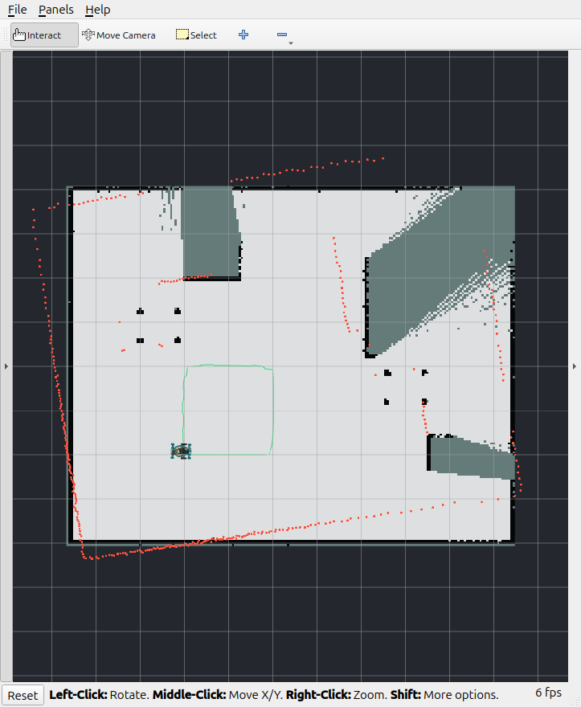<figcaption>그림 2. 작업대 장면에서 저장한 실제 RViz 지도. 낮은 2D LiDAR가 상판 전체를 관측한 것은 아니다. 경로 계획에서는 알려진 테이블 footprint를 별도 keep-out prior로 사용한다.</figcaption></figure>

# 08. 평가 지표·좌표 정렬·판정 기준

SLAM 정확도와 주행 정확도는 서로 다르다. SLAM이 실제 로봇의 틀어진 궤적을 정확히 추정해도 로봇이 목표 경로를 잘 따라갔다고 할 수 없다. 엔코더 제어 시험에서 작은 ATE와 큰 복귀 오차가 동시에 나온 이유다.

`Experiment.sample()`은 truth 메시지의 획득 시각에 해당하는 map→base TF를 조회한다. 저장 간격은 대략 0.1 simulation seconds다. SLAM과 world의 좌표 차이는 **첫 유효 pose 쌍의 위치·방향**으로 정렬한다. 전체 궤적을 최적으로 맞추는 Umeyama/least-squares alignment가 아니다. 최초 한 쌍의 추정 오차가 전체 정렬에 영향을 줄 수 있다.

```text
R = Rot(yaw_truth_first - yaw_slam_first)
aligned_slam_i = R*(slam_xy_i - slam_xy_first) + truth_xy_first
ATE_RMSE = sqrt(mean(||aligned_slam_i - truth_xy_i||^2))
return_error = ||truth_xy_last - truth_xy_first||
waypoint_position_error = ||truth_xy_arrival - goal_world_xy||
waypoint_heading_error = wrap(goal_heading - truth_heading_arrival)
```

carry의 방향 오차 부호는 목표-실제다. 과거 square metric의 `truth_final_heading_change_deg`는 실제 최종-시작 방향 차이다. 두 필드를 동일한 부호 정의라고 가정하지 않는다. odom sample은 최신 수신값을 함께 저장하므로 truth/SLAM과 정확히 같은 시각으로 보간한 odom 비교가 아니다. 엄밀한 sensor fusion 분석에는 추가 동기화가 필요하다.

square baseline version 2의 주요 조건은 완료 여부, 주행 시험 여부, ATE <0.15 m, 실제 복귀 <0.20 m, 방향 복귀 <15°, occupied cell의 벽 근접 비율 >0.85, known area >5 m², 8개 motor effort 기록이다. 최초 25 cm smoke에는 마지막 방향 조건이 없는 구 판정식이 쓰였다. 그 `baseline_pass=true`를 최신 기준 통과로 재해석하지 않는다.

carry의 사전 기준은 각 지점에서 map 위치 오차 <0.03 m, 실제 위치 오차 <0.10 m, 실제 방향 오차 절댓값 <15°다. 3개 waypoint가 모두 통과하고 전체가 완료되어야 navigation_pass가 true다. 이 기준은 현재 열린 장면의 기능 확인 기준이며 조작 정밀도나 실물 안전 기준이 아니다.

지도 벽 거리 metric은 점유 cell을 장면의 알려진 벽/장애물 박스와 비교한다. 테이블·로봇 등의 점유가 섞인 조작 장면에서 같은 metric을 일반 지도 품질로 해석하지 않도록 carry 최종 report에서는 해당 필드를 제외했다. carry의 `truth_return_distance_m` 역시 시작점으로 돌아오는 임무가 아니므로 실패 지표로 쓰지 않는다.

# 09. 초기 정지 확인과 사각 경로 비교

11월 11일 초기 확인에서는 정지 상태 5초 동안 scan 25개와 정렬 pose 48개를 기록하고 202×162 지도를 저장했다. known area 약 0.9975 m², occupied cells 30, baseline_pass=false였다. 이 단계에서 아직 바퀴 주행과 동적 SLAM은 검증되지 않았다.

11월 12일에는 정지 수신을 다시 확인하고 25 cm smoke를 수행했다. 이어 1.2 m 변의 encoder-feedback 경로를 시작했으나 첫 시도는 ROS context 중단으로 metrics가 없었다. 새 월드를 만들지 않고 재시도한 시험은 장애물 0.28 m 조건에 걸려 정지했다. 두 시도는 완주 데이터와 분리했다.

| 시험 폴더 | 상태 | ATE RMSE [mm] | 실제 복귀 [cm] | 실제 방향 변화 |
|---|---|---:|---:|---:|
| checkpoint_20261111 | 정지 수신 | 주행 지표 아님 | 주행 지표 아님 | 해당 없음 |
| initial_stationary | 정지 재확인 | 주행 지표 아님 | 주행 지표 아님 | 해당 없음 |
| smoke_025m | 명령 경로 완료, 구 판정 | 3.765 | 13.659 | 최신 판정 미적용 |
| baseline_12m | context 중단 | metrics 없음 | 평가 제외 | 평가 제외 |
| baseline_12m_retry | 장애물 정지 | 완주 비교 제외 | 완주 비교 제외 | 완주 비교 제외 |
| baseline_12m_fresh | encoder 제어, 복귀 기준 미달 | 5.823 | 59.348 | -37.908° |
| slam_feedback_12m | map 제어, 기준 통과 | 7.921 | 3.983 | -10.383° |

fresh encoder 시험은 616개 pose sample, scan 319개, 실제 경로 길이 약 4.651 m였다. SLAM feedback 시험은 pose 615개, scan 311개, 실제 경로 약 4.660 m였다. 같은 질량·물성·모터 조건에서 제어 피드백을 바꾼 각 1회 비교다. ATE가 encoder 제어 때 더 작았다는 사실이 encoder 주행이 더 정확하다는 뜻은 아니다.

<figure>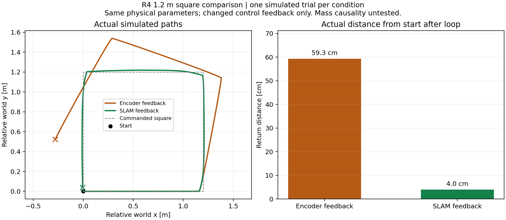<figcaption>그림 3. 저장된 trajectory/metrics로 생성한 encoder 대 SLAM feedback 비교. SLAM 위치 추정 정확도와 실제 시작점 복귀 정확도를 나누어 읽어야 한다. 단일 시험의 기술 통계다.</figcaption></figure>

<figure>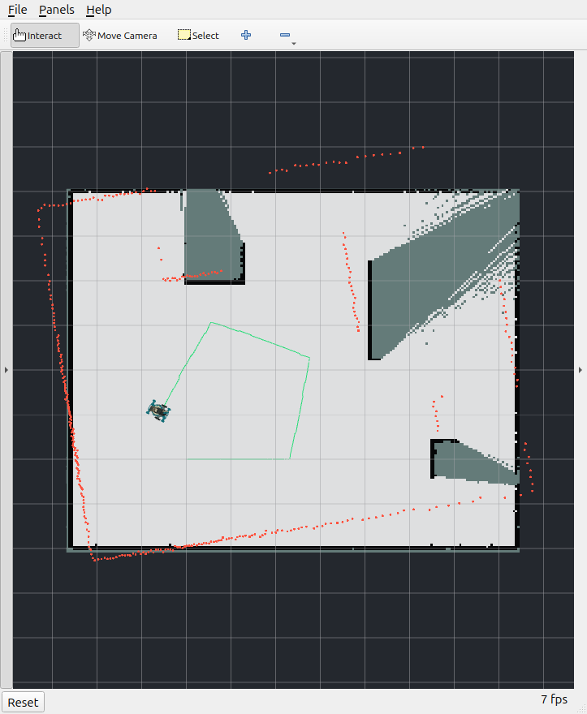<figcaption>그림 4. encoder feedback 1.2 m 시험 완료 시 실제 RViz 화면. 명령 경로가 끝났어도 simulator truth에서는 시작점에서 59.35 cm 떨어져 있었다.</figcaption></figure>

<figure>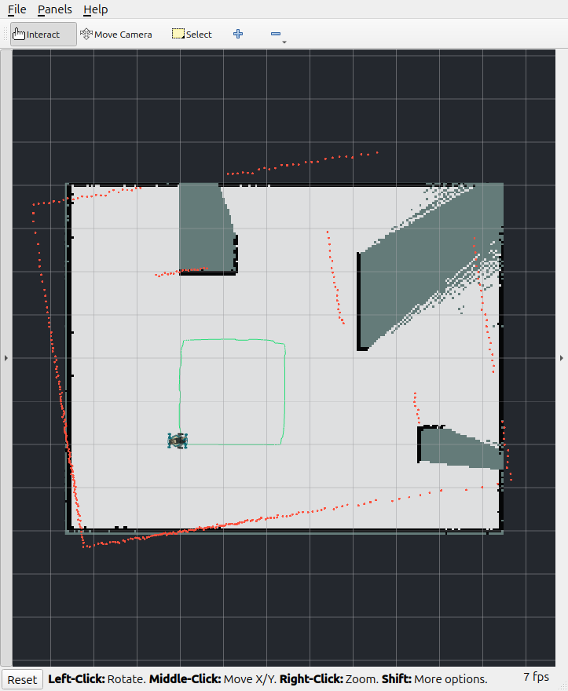<figcaption>그림 5. map feedback 비교 시험 완료 시 실제 RViz 화면. 실제 복귀 오차는 3.98 cm로 줄었지만 방향 차이는 약 -10.38°가 남았다. 실물이나 반복 신뢰성의 검증은 아니다.</figcaption></figure>

# 10. 누적 오차와 ‘무게 때문인가’의 해석

사용자가 누적되는 이유가 무게인지 질문했다. 저장 데이터로 확인한 것은 encoder가 추정한 회전량과 실제 회전량의 차이이며, 무게의 인과 효과는 분리하지 않았다. 회전이 조금씩 덜 이루어지면 encoder 좌표계는 올바른 직각을 돌았다고 판단해도 실제 경로의 방향은 누적해서 틀어질 수 있다.

fresh encoder 시험에서 unwrapped encoder 순회전은 358.325°, 실제 순회전은 322.092°였다. 실제/encoder 비율은 0.898883이었다. encoder상 시작점 복귀는 약 4.008 cm였지만 truth 복귀는 59.348 cm였다. 한 시험의 전체 회전 비율로 환산한 유효 축간거리 약 0.177999 m는 당시에는 원인 진단용 숫자였고 그 시험의 제어에 적용하지 않았다. 나중의 별도 식별 시험과 구분한다.

바퀴 최대 명령 토크는 좌 0.03648, 우 0.03385 N·m로 상한 1.4 N·m에 닿지 않았다. 이 데이터는 해당 주행에서 단순히 모터 cap에 막혔다는 설명을 지지하지 않는다. 파지 시도 중에는 다른 관절과 바퀴가 cap에 닿은 기록이 있으므로 모든 작업으로 일반화하지 않는다.

| 원인 후보 | 가능한 작용 | 아직 필요한 분리 실험 |
|---|---|---|
| 무게·무게중심·관성 | wheel normal force와 회전 접촉 변화 | 형상과 자세를 유지하고 payload 질량만 변경 |
| 마찰·슬립 | wheel rotation과 실제 이동의 차이 | 마찰·속도·회전 방향을 한 변수씩 비교 |
| 유효 r/b | encoder 거리·방향 변환 scale 오차 | 독립 직진·양방향 회전 식별 후 다른 경로 검증 |
| caster 접촉 | 회전 저항·하중 분배 영향 | caster parameter만 바꾸는 비교 |
| 지연·가감속 | 과도 응답·정지 시 잔여 이동 | 같은 geometry에서 속도와 ramp만 비교 |
| sensor/TF 시간 | 움직이는 자세와 scan의 잘못된 결합 | 획득 시각 보존·TF 조회·지연 로그 검증 |

팔을 완전히 제거하는 비교는 무게 외에 충돌 형상·센서 가림·관성까지 바꾸므로 순수 무게 실험이 아니다. 이후 연구 계획에서는 변경한 변수, 고정한 변수, 식별용 데이터와 평가용 데이터를 분리해야 한다. 이번 유효 odom 보정은 오차를 줄이는 모델 계수를 제공할 뿐 슬립·무게·caster 중 하나를 원인으로 확정하지 않는다.

<figure>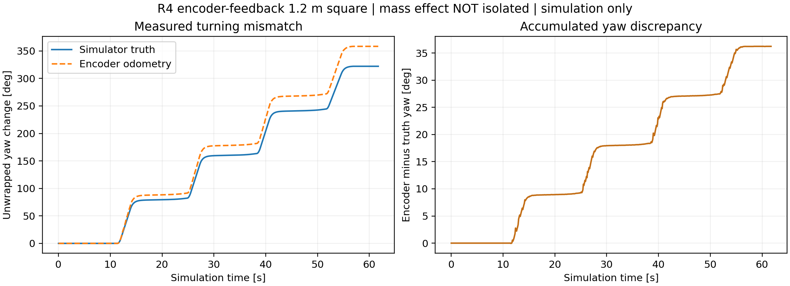<figcaption>그림 6. encoder와 truth 회전량의 차이를 분석한 기존 진단 그림. 표시된 약 0.178 m는 이 시점에는 회전 비율의 등가 해석이며 실물 바퀴 간격 측정값이 아니다.</figcaption></figure>

# 11. 로봇 팔 기본 움직임 확인

`test_arm.py`는 관절 여섯 개를 각각 두 목표로 이동시킨 뒤 zero 근방으로 돌아오게 한다. 목표 명령은 20 Hz이며 ramp는 기본 1.5 s, hold는 1 s다. hold의 마지막 부분에서 평균 절대 각도 오차를 계산하고 3° 미만인지 검사한다. 베이스에는 0 속도를 발행하고 feedback freshness, 관절 한계와 finite 값, 기울기를 감시한다.

최초 `arm_joint_smoke`는 기존 GUI와 센서가 종료된 상태에서 준비 단계에 실패한 기록이다. 모터가 움직이다 실패한 것으로 분류하지 않는다. 실제 동작 검증은 `arm_joint_smoke_retry`다. 12개 구간 전부 통과했고 1,182개 sample, 최대 베이스 변위 0.001959 m를 기록했다.

| 관절 | 목표 [rad] | hold 평균 절대 오차 [°] |
|---|---|---|
| shoulder_pan | +0.18 / -0.18 | 0.0477 / 0.0472 |
| shoulder_lift | +0.18 / +0.32 | 0.2993 / 0.1773 |
| elbow_flex | +0.18 / -0.18 | 0.7987 / 0.5470 |
| wrist_flex | -0.18 / -0.32 | 0.5007 / 0.5335 |
| wrist_roll | +0.25 / -0.25 | 0.0874 / 0.0884 |
| gripper | +0.30 / -0.20 | 0.0868 / 0.0558 |

작은 각도의 단일 관절 추종이 전 작업공간, 자기충돌, 큰 하중, 동시 관절 이동, 파지 후 운반 자세의 안정성을 보장하지 않는다. 실제로 이후 파지 attempt2의 별도 접힘 자세에서는 elbow 오차가 약 0.578 rad까지 커졌다. smoke 통과와 조작 실패는 모순이 아니라 시험 조건의 차이다.

<figure>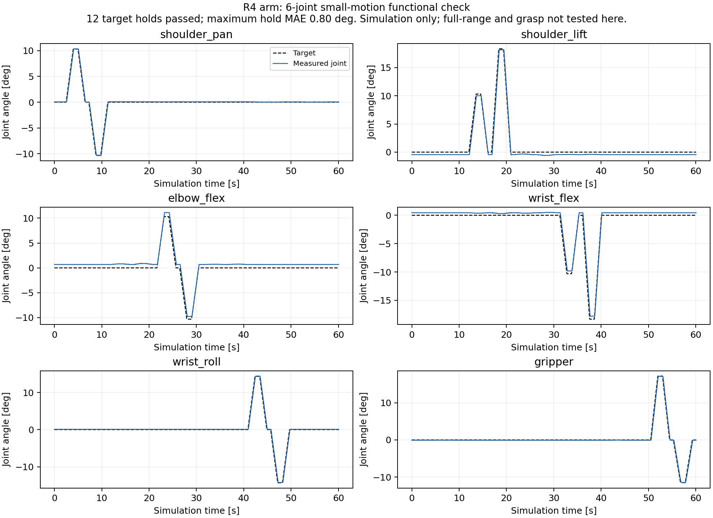<figcaption>그림 7. 저장된 팔 목표/실제 관절 각도 그림. 작은 범위의 12개 유지 구간 검증이며 full-range 보정이나 물리 파지 성능이 아니다.</figcaption></figure>

# 12. 작업대 장면·RGB 인식·팔 접근

작업대 두 개는 0.50 × 0.40 m 상판, 높이 0.26 m로 구성했다. pickup center는 (-1.50, 0.45), delivery center는 (1.30, -0.25) m다. 초기 빨간 cube의 center는 (-1.50, 0.272, 0.276) m, 크기는 각 변 0.032 m, 질량은 0.010 kg다. pickup과 delivery의 명목 위치는 장면 prior다.

RGB-D는 사용하지 않았다. 손목 RGB 영상, CameraInfo의 intrinsics, URDF FK로 얻은 camera pose, 알려진 cube 크기와 table height를 썼다. 붉은 pixel을 threshold한 bbox를 구하고, 알려진 크기의 3D cube를 카메라에 투영한 bbox와 least-squares로 맞춘다. z는 알려진 높이로 고정하고 x/y와 yaw를 보정한다. 일반 물체의 depth를 단안으로 복원하는 범용 모델이 아니다.

attempt2의 bbox는 [43, 0, 96, 57] pixel이며 fit RMSE는 약 0.453 pixel이었다. 이는 bbox 모델의 pixel 잔차이며 실제 물체 위치 오차나 파지 성공 확률과 같지 않다. 영상 경계에서 잘린 bbox 축은 fitting에서 구분해 사용한다. 빨간색 threshold는 조명·재질·다른 빨간 물체에 취약하고 표면·occlusion의 일반화를 검증하지 않았다.

<figure>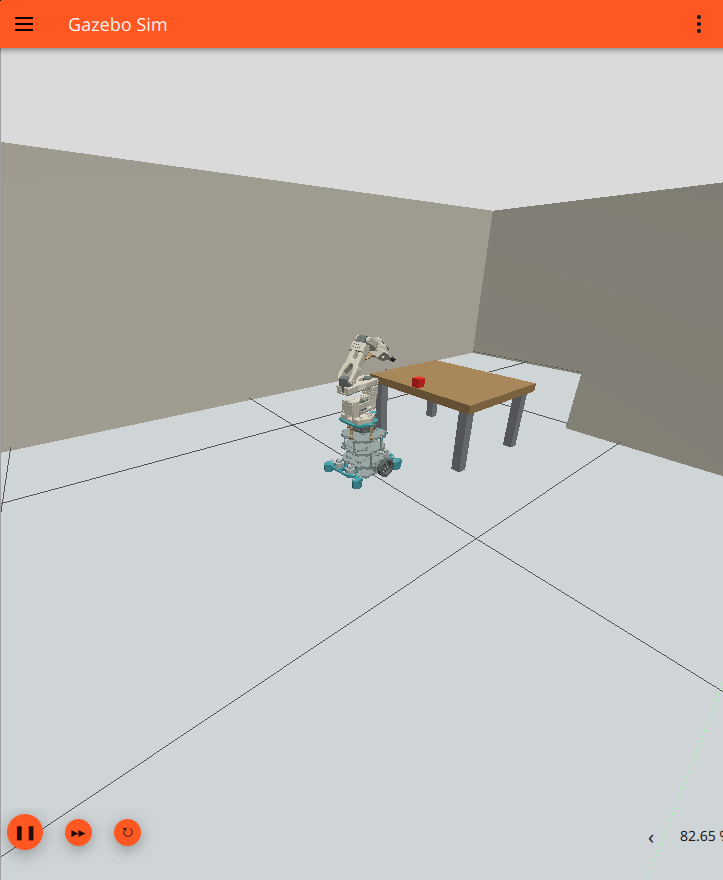<figcaption>그림 8. 작업대·빨간 cube와 결합 로봇을 배치한 실제 Gazebo 화면. 상판 높이와 cube 크기를 알고 있는 기능 시험 장면이다.</figcaption></figure>

<figure>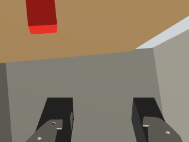<figcaption>그림 9. attempt2에서 저장한 손목 RGB 센서의 실제 pixel. depth 영상이 아니다. 알려진 cube template과 높이 prior로 위치를 보정했다.</figcaption></figure>

팔 FK/IK는 `arm_kinematics.py`가 생성 URDF를 읽어 계산한다. 5개 팔 관절에 대해 bounded least_squares를 풀고 gripper는 별도 목표로 쓴다. 여러 seed를 사용하지만 동역학·충돌·실물 servo 특성까지 최적화한 motion planner는 아니다. 위치 오차가 5 mm를 넘는 IK 결과는 접근을 중단한다.

`move_arm()`은 최대 변화량과 약 0.22 rad/s 기준으로 보간 시간을 정하고 정착 후 첫 5관절 오차가 0.12 rad보다 크면 실패로 기록한다. gravity sag는 관절 오차 피드백으로 목표를 제한적으로 보정하며 원래 joint/torque cap 안에서 수행한다. 물체 truth 위치로 TCP를 쫓지 않는다. 베이스는 조작 중 map pose 유지 제어를 한다.

# 13. 물리 파지의 시도·실패·보존한 증거

자유 물체를 집는 pick_place 장면에서는 물체를 부착하거나 teleport하지 않고 손가락 접촉과 마찰로 집도록 했다. 최종 mission_pass는 모든 시도에서 false다. stage 이름에 `lift_verified`가 한 번 등장했다는 사실만으로 전체 임무를 완료했다고 해석하지 않는다.

**attempt1:** 지도 작성, pickup 이동, RGB 보정, 접근까지 진행했으나 물체가 밀려 올라가지 않았다. 물체 최대 center 높이는 약 0.276510 m, 초기 약 0.275999 m와 거의 같았다. 원본 손의 단일 convex collision hull이 손가락 사이의 빈 파지 공간까지 메우는 현상을 확인했다.

생성 장면의 손 충돌을 hand body와 finger pad 박스로 분리했다. gripper_link의 body 크기는 (0.066, 0.050, 0.055), pad는 (0.012, 0.013, 0.038) m다. moving jaw의 body는 (0.024, 0.048, 0.043), pad는 (0.010, 0.013, 0.038) m다. 실제 위치·회전은 prepare.py의 tool-relative transform을 따른다. 접촉 마찰은 0.8로 설정했으며 실물 pad 재질의 식별값이 아니다. 원본 visual mesh·질량·모터 cap은 유지했다.

**attempt2:** 두 손가락과 cube의 접촉 및 단일 lift가 관측됐다. 물체 최대 center 높이는 0.362502 m로 약 8.65 cm 상승했다. 이후 TCP를 별도의 접힘 운반 자세로 바꾸는 과정에서 팔 추종이 실패했고 물체가 바닥으로 떨어졌다. 기록된 elbow 오차는 0.577746 rad(약 33.1°), 최종 물체 z는 약 0.016 m였다. 전체 이송·놓기 성공으로 분류하지 않는다.

**attempt3:** 불필요한 접힘 자세 변경을 제거했지만 새 초기 상태에서 다시 물체가 앞쪽으로 밀려 lift에 실패했다. 최대 높이는 0.276453 m였고 물체는 테이블에 남았다. 사용자가 여기서 실험 종료를 요청해 session_stop을 보존했다. 해당 중지는 이후 사용자의 재개 요청으로 해제됐지만 과거 저장본은 유지했다.

**resume_grasp_bench_01:** fixed finger에 약 7 mm 삽입 여유를 주고 0.08 rad/s로 천천히 닫았다. 양 손가락 contact가 지속되고 관절이 부하를 받는지 확인한 뒤 실제 gripper 위치보다 0.04 rad 더 닫는 목표로 유지했다. 접촉 확인 후 잠깐 0.364185 m까지 상승했으나 정착 중 물체를 놓쳐 최종 z는 0.016 m였다. 최종 유지 판정에서 lift 실패가 기록됐다. “전혀 들리지 않았다”와 “일시적으로 들렸지만 유지하지 못했다”를 구분해야 한다.

| 시험 | 최대 물체 center z [m] | 최종 z [m] | 결론 |
|---|---:|---:|---|
| pick_place_attempt1 | 0.276510 | 0.276000 | 밀림, lift 실패 |
| pick_place_attempt2 | 0.362502 | 0.016000 | 단일 상승 후 자세 변경 중 낙하 |
| pick_place_attempt3 | 0.276453 | 0.276000 | 테이블 위, lift 실패 |
| resume_grasp_bench_01 | 0.364185 | 0.016000 | 접촉·일시 상승 후 유지 실패 |

<figure>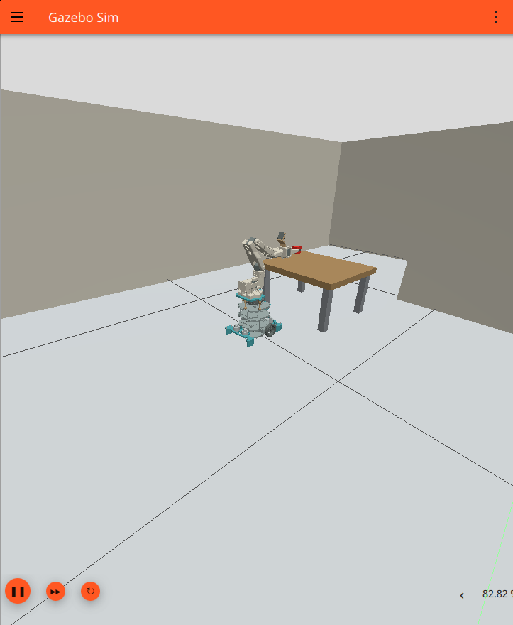<figcaption>그림 10. attempt2의 실제 단일 lift 순간. 뒤에 접힘 자세 전환 실패와 낙하가 있으므로 ‘완전한 집기·운반·놓기 성공’ 사진으로 사용하지 않는다.</figcaption></figure>

<figure>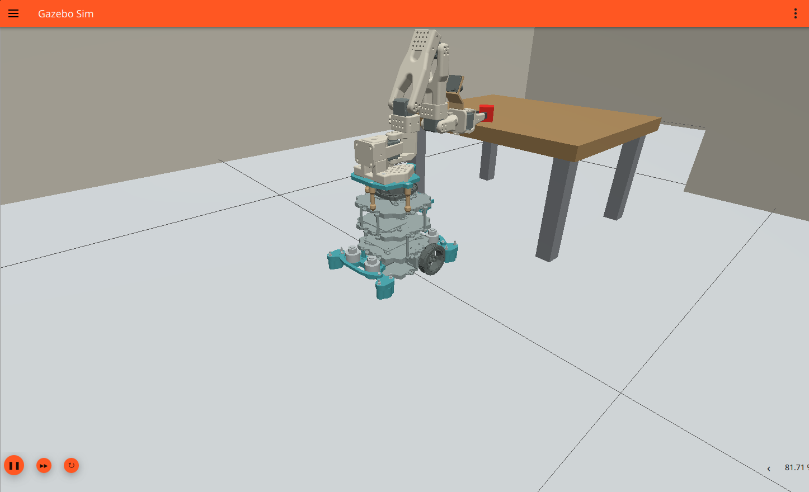<figcaption>그림 11. attempt3의 lift 단계 Gazebo 화면. 물체 상승 여부는 이 정지 화면의 인상보다 object_evaluation.json의 높이 궤적으로 판단한다.</figcaption></figure>

<figure>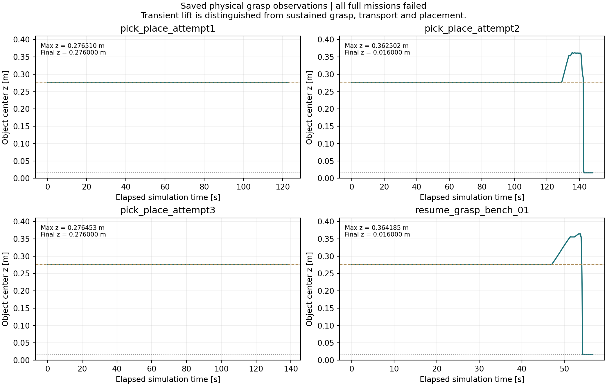<figcaption>그림 12. 저장된 object_evaluation.json을 simulation time 기준으로 다시 그린 높이 변화. attempt2와 재개 bench의 일시 상승 뒤 낙하를 확인할 수 있다. 새 실험 데이터가 아니다.</figcaption></figure>

접촉 sensor topic은 `<contact><topic>` 아래에 넣어야 실제 contact publisher에 적용됐다. 과거 sensor 직속 topic만 지정한 문제를 수정했다. contact 메시지는 최대 20 Hz로 기록하도록 제한했지만 실제 수신 수와 저장 수는 다를 수 있다. `/evaluation/object_odom`은 결과 평가에만 사용했다.

재개 bench 이벤트에는 UTC가 03:15대에서 05:04대로 크게 건너뛰는 반면 sim time은 약 30.6→63.1 s인 구간이 있다. VM 일시중단이나 host clock 변화 등이 가능한 원인이지만 정확한 원인은 확인하지 않았다. 해당 구간의 동작 시간·속도는 UTC 차이로 계산하지 않는다. simulation clock과 프레임 monotonic 기록을 대조해야 한다.

이후 사용자가 파지 개발을 나중의 VLA로 미루고 이미 든 물체의 이동만 요청했다. 이 실패를 추가 수정하기보다 범위를 바꾸었다. 다음 Codex도 사용자와 연구 범위를 다시 정하기 전 파지 튜닝을 자동 재개하지 않는다.

# 14. 이미 든 상태의 carry fixture

carry 시나리오는 pick_place의 작업대·손 충돌 근사를 재사용하되 자유 물체 `task_cube`를 제거한다. 로봇 내부에 `held_payload` 링크를 추가하고 `held_payload_fixture` fixed joint로 gripper_link에 연결한다. payload의 box collision과 visual, 10 g mass와 cube inertia를 물리에 넣는다. 단순 화면 장식만 붙이는 것이 아니다.

물체 중심의 tool-relative offset은 (-0.016, 0, -0.012) m다. carry 동안 팔 다섯 관절 목표는 0 rad, gripper 목표는 0.06 rad다. 실제 관절은 중력과 PD에 따라 약간 처질 수 있다. fixed joint 때문에 payload가 손에서 미끄러지거나 떨어지는 상황은 이 시험에서 평가할 수 없다.

| 항목 | 값 |
|---|---|
| payload box | 0.032 × 0.032 × 0.032 m |
| mass | 0.010 kg |
| attachment | fixed_joint_initial_fixture |
| simulated total mass | 2.732773669 kg |
| mapping motion | 한 변 1.0 m의 map-feedback survey |
| carry waypoint 수 | 3 |
| grasp_tested / placement_tested | false / false |
| learned policy / RGB-D | 사용하지 않음 |

<figure>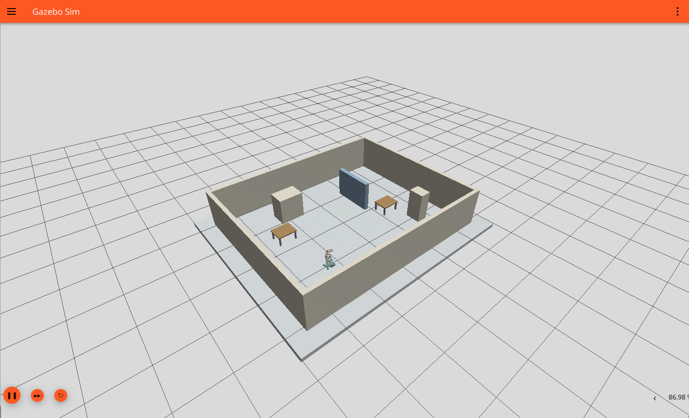<figcaption>그림 13. 보정 후 carry 시작 시 물체를 고정해 든 실제 Gazebo 화면. 자동 follow를 제거한 뒤의 사용자 시점을 그대로 저장했다. 조작 정책이 잡는 과정은 포함하지 않는다.</figcaption></figure>

이 조건은 파지와 이동의 의존성을 분리해 이동 환경을 먼저 확인하려는 목적에 맞는다. 다만 팔 자세 변화, payload 흔들림, 그리퍼 힘 부족, 동적 slip, 높은 무게중심, 다양한 물체의 크기·질량·형상은 검증하지 않았다. 이후 carry 성능 비교에서는 fixture라는 조건을 모든 표·사진·영상에 표시해야 한다.

# 15. waypoint·경로 계획·주행 제어의 구체적 동작

목표는 world 좌표로 정하고 초기 spawn을 기준으로 map 좌표로 바꾼다. 현재 기본 spawn yaw는 0이다. 다음 변환은 map frame이 초기 spawn과 정렬된다는 현재 구성의 가정을 포함한다. map 재로딩·다른 초기 정렬·실물 global localization에서는 별도 registration이 필요하다.

```text
p_map = Rot(-spawn_yaw) * (p_world - spawn_xy)
heading_map_goal = heading_world_goal - spawn_yaw
```

| 목표 | world x [m] | world y [m] | world heading |
|---|---:|---:|---:|
| pickup_standby | -1.50 | -0.12 | +90° |
| transit | 0.00 | -0.70 | 0° |
| delivery_standby | +1.30 | -0.70 | +90° |

`grid_planner.py`는 실제 `/map`을 읽고 unknown cell 및 occupancy≥65를 막는다. 테이블 footprint prior도 추가한다. distance transform으로 0.19 m 여유를 팽창하고 8-neighbor A*를 수행한다. 대각 이동 시 양쪽 직교 cell을 확인하고, 직선 visibility 검사로 경로를 단순화한다. start/goal이 unknown 또는 inflated cell이면 실패한다. 실제 관측하지 않은 영역을 임의로 free로 만들지 않는다.

현재는 waypoint마다 한 번 경로를 만들고 전방 스캔을 감시하며 따라간다. Nav2 전체 stack, dynamic obstacle tracking, 지속적 local replanning, 3D collision checking을 구현한 것이 아니다. map origin quaternion은 planner에서 일반적으로 처리하지 않고 x/y origin만 사용한다. spawn yaw가 바뀐 테이블의 사각 keep-out도 중심만 회전 변환하고 축 정렬 w/h를 그대로 쓰므로 회전된 장면의 일반화는 검증해야 한다.

carry의 베이스·팔 target 발행은 0.05 s timer, 목표 20 Hz다. 경로 point의 방향 오차가 0.25 rad보다 작을 때만 전진하며 속도는 min(0.08, 0.6×거리) m/s다. 각속도는 1.5×방향 오차를 ±0.5 rad/s로 제한한다. 중간 route point 도착 반경은 0.045 m, 최종 route point는 map tolerance 0.03 m의 0.85배, 즉 0.0255 m다.

전방 ±0.28 rad의 유효 range 최솟값이 0.19 m보다 작고 전진하려 하면 정지 오류를 낸다. 이 단순 front stop은 로봇 전체 swept volume이나 측면·뒤쪽의 장애물을 완전히 보호하는 기능이 아니다. 실제 footprint, 센서 원점, 정지 거리와 같은 수치로 간주하지 않는다.

경로 도착 뒤 0.5 s 멈추고 최종 heading을 맞춘다. `abs(error)<0.025 rad`가 되면 정지하며 각속도는 1.3×error, 최대 ±0.4 rad/s다. 이후 2 simulation seconds 정착하고 최종 map/truth 오차를 기록한다. 최종 회전 뒤 SLAM pose 보정이 생겨 위치 오차가 바뀔 수 있으며, 보정 후 마지막 map 오차 2.967 cm는 3 cm 기준에 가깝다. 더 강한 반복성 확인에서는 이 여유도 보아야 한다.

feedback이 3 wall seconds보다 오래되거나 truth로 평가한 기울기가 15°를 넘으면 중단한다. 구간별 simulation/wall deadline도 있다. 기울기 감시는 현재 시뮬레이터 truth에 의존하므로 그대로 실물 controller의 안전 감시라고 설명하지 않는다. 실물 실행 경로에는 실제 IMU 등으로 대체해야 한다.

# 16. 독립적인 encoder odometry 식별

보정 전 carry는 위치는 약 2.2~2.5 cm 이내였지만 마지막 방향 오차가 10.012°였다. 기존 한 경로의 진단 비율을 그대로 최종 성능으로 쓰지 않고 별도의 `odometry_identification_01` 동작을 수행했다. 식별 도구는 현재 fixture·마찰 조건에서 raw encoder와 simulator truth를 기록한다. 이 과정에서만 truth를 parameter identification의 기준으로 쓴다.

준비 후 전진 0.06 m/s 8 s, 후진 -0.06 m/s 8 s, CCW +0.35 rad/s 20 s, CW -0.35 rad/s 20 s를 명령했다. 각 구간 뒤 2 s 정지하여 응답을 포함한 끝 상태를 얻었다. 명령값×시간을 실제 이동으로 가정하지 않고 관측된 변위·각도와 quantized encoder를 사용했다.

| 구간 | 실제 전방 변위 [m] | 실제 yaw [rad] | Δencoder L / R [rad] |
|---|---:|---:|---|
| forward | +0.478463199 | 약 0 | +14.499186 / +14.499186 |
| reverse | -0.478005534 | 약 0 | -14.485381 / -14.485381 |
| counterclockwise | -0.000260918 | +5.705226 | -15.395031 / +15.378157 |
| clockwise | -0.000271133 | -5.705146 | +15.378157 / -15.393497 |

truth의 yaw를 unwrap하고 encoder를 truth 구간 끝 timestamp에 보간한다. 직진의 전방 변위는 미세 구간의 중간 heading 방향에 위치 변화를 투영해 누적한다. 전진/후진 데이터를 모아 공통 유효 반경을 least squares로 구한 뒤 회전 두 방향에서 유효 축간거리를 구한다.

```text
a_k = (ΔqL_k + ΔqR_k)/2
r_eff = sum(a_k * ds_k) / sum(a_k^2)       # straight segments
b_eff_turn = r_eff*(ΔqR - ΔqL)/Δyaw_truth
b_eff = mean(b_eff_CCW, b_eff_CW)
```

식별값은 r_eff=0.032999241791 m, b_eff=0.177990086838 m다. 전진/후진 개별 r은 0.032999313585 / 0.032999169861 m, CCW/CW 개별 b는 0.177993275914 / 0.177986897761 m였다. 양방향 일관성은 이번 데이터에서 좋았으나 다른 속도·하중·마찰로의 일반화는 별도 검증 대상이다.

식별 도구는 r이 0.025~0.045 m, b가 0.13~0.25 m 범위인지와 방향별 r 편차 2%, b 편차 5% 조건을 확인한다. 자동 검사는 implausible fit을 막는 최소 조건이며 파라미터 불확도나 신뢰구간 계산은 아니다. 좌우 radius를 각각 식별한 것도 아니며, 공통 반경 하나를 쓴다.

`MotorSystem.cc`의 명령 geometry와 odom geometry를 분리했다. physical/command r=0.033, b=0.160 m를 유지하고 encoder integration에만 식별값을 적용한다. 따라서 모델의 실제 바퀴 간격을 0.178 m로 늘린 것이 아니다. 이 값은 현재 접촉·슬립·근사를 포함한 유효 변환 계수다.

<figure>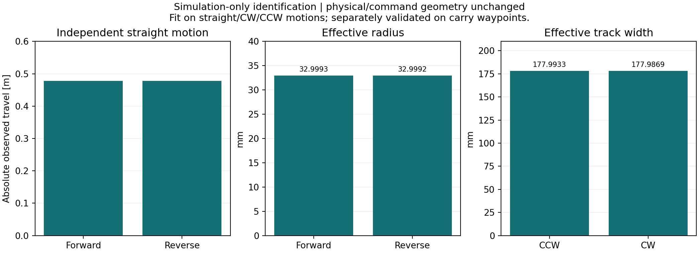<figcaption>그림 14. 독립 식별 구간의 실제 변위·회전과 방향별 유효 geometry. 원본 raw_identification.json 및 identification.json에서 재구성한 그림이다.</figcaption></figure>

활성 파일은 `slam/calibration/carry_simulation.yaml`이며 source trial, seed, friction, payload mass, profile, nominal geometry, hardware_calibrated=false를 기록한다. `experiment.yaml`에서 carry 시뮬레이션에만 기본 선택한다. scenario/seed/friction/payload와 파일에 명시된 profile·nominal geometry가 달라지면 거부한다. inertia, payload offset, 모든 소스 변경까지 자동 감지하는 완전한 조건 검증기는 아니므로 snapshot hash도 함께 비교해야 한다.

현재 `start_slam`에는 자동 calibration을 끄는 전용 `--nominal` 플래그가 없다. 새로운 조건에서 재식별하려면 기존 보정 선택을 제거한 별도 config를 prepare.py의 `--config`로 생성한 뒤 launch하거나, 명시적인 calibration selector를 구현해야 한다. 현재 명령에 존재하지 않는 옵션을 다음 Codex가 추정해서 사용하지 않는다.

# 17. 오류·설정 수정의 내역과 남은 로그

| 문제 | 확인 근거 | 수정 및 검증 범위 |
|---|---|---|
| 제자리 회전 scan gate | slam_toolbox의 precise check=false 경로 | true, distance 0.03 m, heading 0.02 rad |
| /scan reliability mismatch | 시작 로그의 RELIABILITY incompatibility | publisher를 Reliable depth 5로 변경 |
| 초기 scan에 TF history 없음 | scan stamp가 TF cache보다 이른 시각 | 원래 stamp의 odom TF가 없으면 대기/폐기 |
| odom 발행 경계 | 0.02 비교의 float 누적, 약 47.6 Hz 관측 | 1e-9 비교 여유, audit 50 Hz 확인 |
| odom과 명령 geometry 결합 | 동일 radius/separation 변수 사용 | encoder 전용 geometry 추가 |
| seed 상수 | launch cmd에 literal 42 | resolved seed에서 읽도록 수정 |
| 잘못된 임시 carry report | stationary/baseline report가 먼저 출력 | report emit=False 후 carry 결과 한 번 저장 |
| 도착 반경 하드코딩 | route 최종 point가 0.028 m 고정 | task tolerance의 0.85배 사용 |
| GUI 종료 후 ROS 잔여 | 닫힌 Gazebo 뒤 bridge/SLAM 잔류 | OnProcessExit shutdown, 중복 shutdown guard |
| LiDAR noise schema | type attribute 경고 | noise/type 자식으로 수정 |
| contact topic 위치 | 접촉 publisher 미연결 | contact/topic 아래 지정 |
| Xwayland 검은 캡처 | 초기 QScreen 캡처가 black | XComposite backing pixmap 읽기 |
| 자동 시점 이동 | agent가 /gui/follow 사용 | CameraTracking 제거, 앞으로 follow/move_to 금지 |
| RViz mixed sampler 오류 | 서로 다른 sampler가 초기 texture unit 0 공유 | 지원 GL에서 explicit binding local overlay |

RViz workaround는 원본 ROS 설치 파일을 수정하지 않는다. `prepare_rviz.py`가 offscreen GL context의 ARB_shading_language_420pack 지원과 shader compile/link를 확인하고, indexed image fragment shader에 sampler2D binding=0, sampler1D binding=1을 지정한 resource overlay를 만든다. RViz 프로세스의 AMENT_PREFIX_PATH에만 overlay를 앞세운다. 지원하지 않는 렌더러에서는 upstream shader로 돌아가며 해당 장비에서 같은 오류가 해결된다고 보장하지 않는다.

보정 후 실행에서는 GLSL 오류와 QoS incompatibility가 사라졌고 실제 지도 렌더링을 캡처했다. Gazebo 종료 시 bridge, scan pipeline, robot_state_publisher, SLAM, RViz가 함께 종료되는 것을 확인했다. Gazebo 내부 GUI 종료 과정에는 SIGKILL escalation 메시지가 남았지만 잔여 ROS 프로세스는 없었다. 이를 모든 shutdown 문제가 근본 해결된 것으로 과장하지 않는다.

남은 로그는 VM EGL의 dri2/kms_swrast fallback, SDF parser의 `gz_frame_id` 확장 태그 경고, 초기 RViz scan이 map TF history보다 오래된 경우의 Message Filter info다. 특히 pipeline이 odom TF를 기다려도 첫 map→odom 생성 이전 scan은 RViz에서 한 번 빠질 수 있다. 정상 구간의 audit과 시작 과도 구간을 구분했다. 로그를 숨겨 “오류가 전혀 없다”고 표현하지 않는다.

# 18. 보정 후 별도 carry 검증 결과

식별한 geometry를 고정한 후 fresh world에서 map survey와 기존 세 waypoint를 다시 수행했다. 이 검증 경로는 식별의 직진·양방향 회전과 다르다. simulator truth를 주행 feedback에 넣지 않고 map TF로 제어했다. 모든 지점의 사전 판정 기준은 유지했다.

| 지점 | 이전 실제 위치 [cm] | 보정 후 실제 위치 [cm] | 이전 방향 [°] | 보정 후 방향 [°] |
|---|---:|---:|---:|---:|
| pickup_standby | 2.244792 | 2.151295 | -3.935844 | -1.564811 |
| transit | 2.484746 | 3.600878 | +3.141708 | +0.794090 |
| delivery_standby | 2.207169 | 3.150201 | +10.011946 | +1.026844 |

| 지표 | 보정 전 | 보정 후 |
|---|---:|---:|
| waypoint 통과 | 3/3 | 3/3 |
| map arrival error [cm] | 2.551 / 2.544 / 2.543 | 2.348 / 2.363 / 2.967 |
| SLAM ATE RMSE [cm] | 0.7950 | 1.0790 |
| SLAM heading RMSE [°] | 4.8981 | 0.4347 |
| 실제 경로 길이 [m] | 7.6087 | 7.5921 |
| trajectory samples | 1375 | 1396 |
| scan messages | 688 | 699 |
| known map area [m²] | 18.5188 | 19.9119 |
| grasp / placement tested | false / false | false / false |

방향 오차는 줄었지만 transit·delivery의 실제 위치 오차 및 전체 위치 ATE는 일부 늘었다. 특정 지표 하나만 개선으로 강조하지 않는다. SLAM gate, odom geometry, 도착 반경·주기 관련 정리를 함께 적용했고 시작 timing도 달라질 수 있으므로 개별 수정의 인과 효과나 통계적 개선율을 계산하지 않는다.

보정 후 wheel 최대 effort는 좌 0.03390, 우 0.03362 N·m다. 팔 최대는 elbow 약 0.28934 N·m였다. 이 carry에서는 기본 cap 이내였지만 다른 자세·payload에서도 여유가 같다는 결론은 낼 수 없다. 매우 작은 기울기는 평탄한 현재 fixture 조건에서의 결과다.

<figure>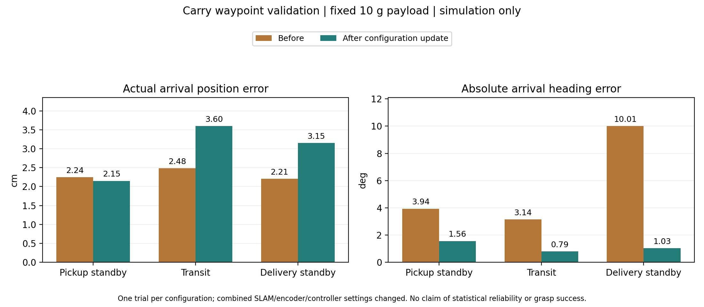<figcaption>그림 15. 동일한 세 목표에서 보정 전후 위치와 방향 오차의 기술 비교. 각 조건 한 번이며 여러 설정의 동시 변경이다. 위치 오차가 일부 증가한 점도 그대로 표시했다.</figcaption></figure>

<figure>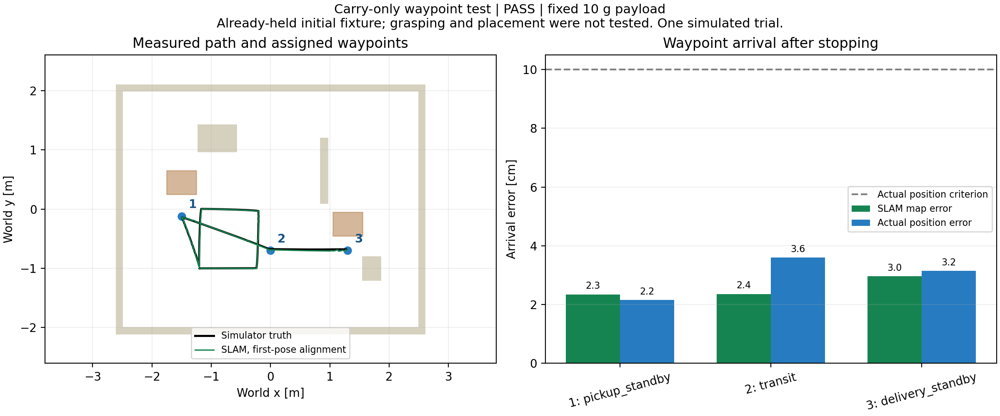<figcaption>그림 16. 보정 후 실제/SLAM 경로와 waypoint arrival error. first-pose alignment를 사용했다. 팔은 물체를 fixed joint로 이미 든 상태다.</figcaption></figure>

<figure>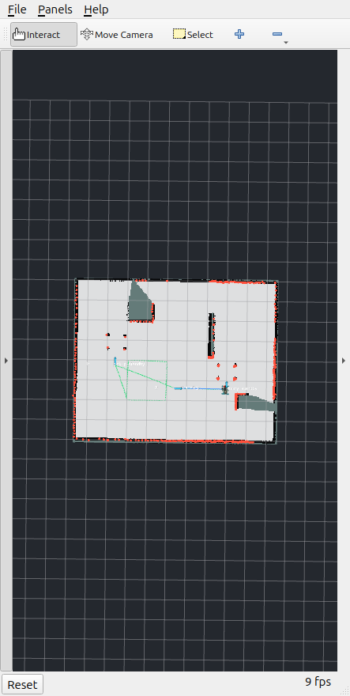<figcaption>그림 17. 보정 후 완료 시 실제 RViz 화면. 목표 화살표·이름과 계획 경로, SLAM 궤적을 표시한다. 숫자 판정은 waypoint_results.json을 기준으로 한다.</figcaption></figure>

지도와 pose graph는 각각 저장했고 serialize 응답 result=0을 확인했다. source/config/generated/binary snapshot과 SHA-256, events, trajectory, waypoint CSV/JSON, 실제 창 MP4, screenshot을 보존했다. carry 시험에 과거 square와 같은 12-topic rosbag을 새로 저장했다고 주장하지 않는다. carry의 원시 증거 형태는 JSON 및 source snapshot과 미디어다.

# 19. 인터페이스 audit와 실물 연결 경계

`audit_base.py`는 이동 publisher를 만들지 않는 read-only 점검 도구다. 기본 모드는 실물 clock(`use_sim_time=false`)이며 simulation은 `--sim`으로 명시한다. `/scan`, `/scan_raw`, `/odom`을 구독하고 실제 획득 시각의 TF, node clock 설정, publisher QoS, `/cmd_vel` driver subscription type을 검사한다.

| 검증 항목 | 저장된 보정 후 audit 결과 |
|---|---|
| pass | true |
| 이동 명령 발행 | 0 |
| scan | 56개, 5 Hz, lds, 360 ray |
| odom | 570개, 50 Hz, odom→base_footprint |
| stamp 역행 / 중복 | 0 / 0 |
| scan age p95 | 0.145 s |
| odom age p95 | 0.002 s |
| scan-time TF 성공 | 52개, 발견 초기 4개 제외 |
| TF 오류 | 없음 |
| raw/processed stamp 일치 | 56개 |
| 확인된 /cmd_vel input | geometry_msgs/msg/Twist |
| use_sim_time | 조회 완료된 데이터 노드 모두 true |

첫 audit 개발 중에는 launch 관리 노드의 wall clock이나 아직 도착하지 않은 static TF를 실패로 잡았다. 관리 노드와 discovery warmup을 구분하도록 고친 뒤 다시 점검했다. 이 제외 규칙과 실패 로그를 보존해 처음부터 모든 검사가 통과한 것처럼 보이지 않게 했다. 별도 ROS domain 47에서 driver가 없는 조건도 시험했고, 센서·TF·cmd_vel 부재를 올바르게 실패로 기록했다.

이 점검은 최소 interface preflight다. 현재 rate 기준은 scan≥3 Hz, odom≥10 Hz이며 실제 장비 주기에 맞춰 검토해야 한다. clock 설정을 가진 모든 외부 노드를 완전하게 인증하는 도구는 아니다. 전복 방지, 실제 brake distance, 기계적 충돌, 관절 안전, 물체 유지 능력을 인증하지 않는다.

ROBOTIS 문서상 Jazzy TurtleBot3는 `TwistStamped`를 기본으로 쓸 수 있고 `enable_stamped_cmd_vel=false`로 Twist를 선택할 수 있다. 현재 simulation은 Twist다. 실물 연결 때 topic 이름이 같다는 이유만으로 연결됐다고 판단하지 않고 실제 driver의 타입을 확인한다. 이 차이를 처리하는 실물 adapter/controller는 아직 연결하지 않았다.

실물에서는 Gazebo clock·truth·시뮬레이션 robot_state_publisher를 함께 쓰지 않는다. 실제 베이스 driver·팔 driver·sensor frame·IMU와 올바른 URDF/extrinsic이 필요하다. 실물 보정은 별도 측정 자료로 수행하고 `carry_simulation.yaml`의 0.178 m를 그대로 옮기지 않는다. 현재 `test_carry`는 truth 평가와 시뮬레이션 fixture를 요구하므로 실물용 런처가 아니다.

```bash
# 실제 TurtleBot의 driver가 실행되고 같은 domain/network를 확인한 뒤
export ROS_DOMAIN_ID=<실제_TurtleBot과_같은_숫자>
~/r4_lab/check_real_base --output ~/r4_lab/real_base_preflight.json
```

`check_real_base`는 시뮬레이션용 LOCALHOST discovery가 남아 있으면 이 프로세스에서 SUBNET으로 바꾼다. 실제 domain 값이 없으면 종료한다. `hardware_interface.yaml`에 적은 0.05 m/s, 0.3 rad/s, 20 Hz, watchdog 0.3 s는 향후 낮은 속도 시험의 목표 계약이며 이를 강제하는 실물 controller가 이미 배포됐다는 뜻은 아니다.

# 20. 사진·영상의 출처와 재사용 방법

사진은 실제 Xwayland 창의 backing pixmap을 XComposite로 읽어 PNG로 저장했다. 초기 QScreen 캡처는 검은 화면이어서 연구에 부적합한 자료로 남기고 선별에서 제외했다. 실제 창 캡처를 성공한 시점 이후의 자료를 사용했다. 이번 보고서의 이미지 원본 경로와 SHA-256은 `metadata/image_sources.json`에 있다.

녹화는 실제 Gazebo와 RViz 창을 비율 유지하여 두 panel에 넣고 label·UTC를 추가한 H.264 MP4다. 목표 8 fps, 1600×960, 무음이며 `recording.json`, frame별 `frames.jsonl`, 시작 configuration을 함께 저장한다. 녹화 시점은 wall time이다. 시뮬레이션이 느려지거나 VM이 멈추면 simulation time과 같지 않을 수 있다.

카메라 자동 이동은 녹화에 필수인 기능이 아니었다. 과거 agent가 `/gui/follow`를 켜 둬 사용자가 불편을 겪었다. `CameraTracking` plugin을 제거했고 사용자 직접 줌·회전용 InteractiveViewControl만 유지한다. 앞으로 녹화를 이유로 follow/move_to/카메라 pose 변경을 호출하지 않는다. 과거 확대 사진과 자동 추적 영상은 현재 선호 이전에 기록된 자료라고 구분한다.

| 핵심 자료 폴더 | 내용 | 영상 해석 |
|---|---|---|
| selected/ | 초기 주행 사진 4장, MP4 2개 | encoder / map 각 약 36 s, 중간 생략 |
| basic_setup_selected/ | 작업대·단일 lift·팔 그래프, MP4 2개 | 팔 24 s, grasp/lift 약 23 s; 이후 낙하 별도 명시 |
| carry_calibration_selected/ | 보정 비교 그림·사진 2장·MP4 1개 | 약 50 s, 시작과 마지막 접근/도착 |

최근 carry 원본 MP4는 `videos/20261112T052643Z_carry_calibrated_fixed_view/gazebo_rviz.mp4`다. 1,494 frame, wall duration 약 186.751 s로 정상 마감됐다. 선별본은 [0,8] s와 [134,176] s를 이어 총 400 frame이며 마지막 도착이 있는 원본 약 167.36 s를 포함한다. 배속하지 않고 UTC를 유지했다. 정확한 cut은 `video_cuts.json`을 따른다.

PDF에는 사진과 그래프를 넣고 영상 자체는 동봉 ZIP에 둔다. PDF 뷰어별 동영상 재생 호환성을 가정하지 않는다. 그림을 논문에 사용할 때에는 simulator, fixed fixture, 단일 trial, 중간 생략과 부분 성공 범위를 캡션에 유지한다. 원본 실패 데이터는 선별되지 않았어도 삭제하지 않았다.

# 21. 실행·저장·복구를 위한 작업 절차

현재 사용 목적의 기본 시작과 시험은 아래 두 터미널이다. 아래 명령은 문서화된 재현 절차이며 보고서 제작 중 새로 실행하지 않았다. 다음 실험을 실제로 시작하기 전 중복 월드와 제어기가 없는지 확인한다.

```bash
# 터미널 1: fresh world, 현재 carry 전용 보정 자동 적용
~/r4_lab/start_carry

# 터미널 2: 결과 폴더를 새 이름으로 지정
~/r4_lab/test_carry --output ~/r4_lab/slam/results/<새_시험_ID>
```

고정된 geometry로 단순 square를 비교하려면 별도 fresh world에서 `start_slam`, `test_slam --side 1.2 --control-frame map --capture`를 쓴다. 현재 기본 SLAM gate는 과거 비교 당시와 바뀌었으므로 재실행을 원래 시험의 완전한 재현이라고 이름 붙이지 않는다. 당시 snapshot을 기준으로 차이를 기록한다.

```bash
# 수신/TF audit: 로봇을 움직이지 않는 관측 도구
source ~/r4_lab/slam/env.sh
python3 ~/r4_lab/slam/audit_base.py --sim --require-map \
  --output ~/r4_lab/slam/results/<새_시험_ID>/interface_audit.json

# 실제 현재 화면만 저장; camera를 이동시키지 않음
python3 ~/r4_lab/slam/capture_visuals.py <장면_label> \
  --output ~/r4_lab/slam/results/<새_시험_ID>/captures/<label>

# 녹화는 별도 터미널에서 실행 후 Ctrl+C로 정상 마감
python3 ~/r4_lab/slam/record_visuals.py <시험_label>
```

지도는 nav2 map_saver_cli로 저장하고 SLAM graph는 serialize 서비스로 저장한다. `.pgm/.yaml`만으로 내부 pose graph가 모두 저장됐다고 간주하지 않는다. recorder는 종료 signal 후 EOS가 쓰여 MP4가 정상 완결됐는지 metadata와 decode로 확인한다. 에러로 중단된 시험도 error.txt와 마지막 metrics를 저장하고 완주 비교에서 제외한다.

UTM 재시작 후 disk 파일은 남지만 GUI·ROS·녹화 메모리 상태는 복원됐다고 가정하지 않는다. 현재 환경의 설치본을 source하고 새 월드를 시작한다. 이전 물체 위치나 베이스 pose에서 바로 다음 trial을 실행하지 않는다. 서로 다른 scenario가 같은 generated 폴더를 공유하므로 동시 prepare/launch는 피한다.

아카이브의 CMake cache와 실행 PID는 다른 머신의 재현 설정으로 사용하지 않는다. 실제 설치 패키지와 현재 source로 다시 빌드한다. 모든 파일이 자동 portable하다고 보장하지 않으며 절대 경로, architecture, display/Xwayland 및 GPU 기능을 먼저 확인한다.

# 22. 향후 VLA 및 연구 모델 연결의 경계

MolmoAct2가 가장 먼저 붙일 가능성이 높은 모델이며 HomeBody도 참고 의향이 있다. 이는 사용자가 밝힌 후속 연구 방향이지 이번 환경의 구현 완료 항목이 아니다. 모델 download·GPU 추론·학습·benchmark는 수행하지 않았다. 관련 자료를 참고 대상으로 기록했으며 새 논문을 포괄적으로 조사한 최신 survey 보고서는 아니다.

추후 adapter는 RGB camera key/해상도, joint 순서·단위·zero·sign·정규화, gripper 범위, absolute/delta action, action chunk와 제어 주기, 베이스와 팔 skill 호출의 경계를 명시해야 한다. 현재 simulator rad/zero를 모델 카드의 action convention에 그대로 넣지 않는다. 원본 checkpoint와 LeRobot 변환본의 convention도 다를 수 있다.

HomeBody는 상위 공간 기억·skill 조합 방식의 참고 대상으로 취급한다. 해당 프로젝트의 로봇·시뮬레이터·전체 시스템을 이 Gazebo 장면에 재현한 것이 아니다. 현재 map/navigation/arm 함수를 분리해 둔 구조를 후속 설계의 출발점으로 활용할 수 있지만 현재 controller를 해당 연구의 baseline으로 이름 붙이지 않는다.

사용자의 현재 연구 준비 요구를 만족하려면 먼저 반복 가능한 환경, 명확한 관측/action interface, version 고정, 실패를 포함한 logging, 독립 평가 protocol이 필요하다. 모델을 붙이는 작업과 기본 환경 검증을 한 번에 바꾸면 실패 원인을 구분하기 어렵다. 다음 Codex는 실험 계획부터 제시하고 현재 확인된 경계를 유지한다.

# 23. 다음 실험 계획을 세울 때의 미해결 항목

아래는 **아직 수행하지 않은 계획 후보**다. 실행 완료 결과로 인용하지 않는다. 사용자는 다음 Codex와 실험 계획을 세우려 하므로, 우선순위와 가설·통제변수를 정할 출발점으로 제공한다.

| 우선순위 | 질문 | 권장 설계 | 측정 / 주의 |
|---|---|---|---|
| P0 | 현재 carry가 반복 가능한가 | 같은 frozen config에서 fresh world 반복 | 성공률, 위치/방향 분포, timeout, 최소 장애물 여유 |
| P0 | 마지막 도착 기준 여유가 충분한가 | 방향 정착 후 map/실제 위치 오차 추적 | 마지막 map 2.967 cm로 3 cm에 근접 |
| P1 | encoder 보정과 rotation gate 각각의 영향 | nominal/calibrated × old/new gate factorial | 다른 controller 설정 고정, config별 fresh world |
| P1 | 보정값의 경로 일반화 | 식별 경로와 다른 held-out 목표·회전 방향 | 같은 경로의 tuning과 test 혼합 금지 |
| P1 | 속도에 따라 유효 b가 변하는가 | payload·friction 고정, v/w 조건 변경 | yaw scale, slip, torque, stop transient |
| P1 | 무게가 누적 오차에 영향을 주는가 | 모양/팔 자세 고정, mass만 단계 비교 | COM·inertia 변화도 명시, 재식별 여부 고정 |
| P2 | 마찰/caster 효과 | 변수 하나씩 또는 사전 정의 factorial | 단일 성공으로 causal claim 금지 |
| P2 | 센서 delay/noise에 얼마나 민감한가 | baseline/stress·delay를 사전 분리 | stamp 보존, failure와 drop rate 포함 |
| P2 | pose/geometry의 좌표 일반화 | spawn yaw·map origin rotation 변경 | table keepout와 planner의 회전 처리 선행 점검 |
| P3 | 실물로 옮길 수 있는가 | read-only audit→저속 정지/직진/회전→별도 경로 | 실제 IMU, 동작·정지·통신 timeout 검증 |
| 후속 | VLA 파지를 붙일 수 있는가 | action convention 점검→작은 관절 명령→접촉/유지 | fixture 운반과 실제 파지 성공 분리 |

반복 횟수와 seed 수는 가용 시간·분산·실패 비용을 보고 사전 정한다. 이번 자료만으로 필요한 n을 통계적으로 계산할 근거는 부족하다. 예비 반복에서 분산을 추정한 뒤 본 실험의 power·confidence reporting을 설계할 수 있다. 성공 trial만 선별해서 평균을 내지 말고 abort와 실패 원인도 포함한다.

계획서에 trial ID, 코드 hash, config hash, seed, initial pose, fixture 여부, payload mass/offset/inertia, friction, command geometry, odom geometry, sensor noise/delay, map gate, velocity/ramp, goal과 사전 기준을 기록한다. 결과는 truth 평가와 제어 관측을 분리 저장하고, 동기화 오차·bag 손실·VM clock gap도 함께 남긴다.

새 trial의 실험 단위는 fresh world 한 번이다. 같은 월드의 연속 waypoint 세 개는 서로 독립 반복 3회가 아니다. 보정 전후의 각 waypoint 오차 3개를 독립 표본 n=3이라고 가정하지 않는다. 같은 seed라도 callback·render startup timing이 달라질 수 있어 bit-exact deterministic 재현을 주장하지 않는다.

# 24. 다음 Codex가 먼저 읽고 확인할 순서

1. `handoff/START_HERE.md`와 `handoff/NEXT_CODEX_PROMPT.txt`를 읽어 최신 사용자 범위를 확인한다.
2. 이 PDF의 최종 상태·지표 정의·파지 실패·carry fixture·실물 경계를 읽는다.
3. `metadata/experiment_registry.json`, 각 trial metrics/configuration, calibration identification, audit 원본을 대조한다.
4. 현재 process를 새로 조회하고 오래된 PID를 사용하지 않는다. 문서 작성 시점에는 로봇 process가 없었다.
5. current source와 trial snapshot을 구분한다. 오래된 “아직 주행 안 함”, “재개 금지”, “파지 수정 진행 중” 문구는 당시 이력이다.
6. 새 실험을 자동 시작하기보다 사용자가 요청한 실험 계획을 구성하고 가설·조건·사전 판정 기준을 정한다.
7. 실행할 때마다 fresh world와 새 output 경로를 사용하고 snapshot/hash와 핵심 media를 보존한다.

현재 구현을 과대평가하게 만드는 대표적인 오해는 fixed fixture를 파지 성공으로 보는 것, SLAM ATE를 실제 goal 오차로 보는 것, 저장된 pose graph를 loop closure 검증으로 보는 것, 단일 성공을 실물 준비 완료로 보는 것, 유효 축간거리를 실제 치수로 보는 것이다. 이 다섯 가지는 후속 계획과 결과표에서 계속 분리한다.

현재 코드의 추가 제약은 다음과 같다. A*는 axis-aligned map/table 가정과 제한된 line-of-sight simplification을 쓴다. controller는 simple front stop과 고정 지점 계획이며 Nav2 전체 기능이 아니다. carry의 기울기/준비 감시에 truth가 들어가 실물 실행기와 분리해야 한다. calibration guard는 모든 물성 변경을 검출하지 않는다. camera/contact bridge 일부는 pick_place에만 켜져 carry에서 같은 토픽이 다 제공되는 것은 아니다.

# 25. UTM 안의 결과를 macOS로 가져오기

보고서 작성 중 UTM 공유 폴더를 조회했지만 virtiofs/9p/WebDAV 공유 경로는 연결돼 있지 않았다. 일반 계정에서 macOS Downloads를 직접 쓰는 경로가 없고 sudo는 비밀번호를 요구했다. 비밀번호를 요청하거나 임의로 host 설정을 바꾸지 않았다. 게스트의 현재 주소는 HOST_ADDRESS, 기본 gateway는 HOST_ADDRESS이다. 주소는 VM 네트워크가 바뀌면 달라질 수 있다.

처음에는 게스트의 임시 다운로드 페이지를 검토했지만, 사용자가 자신의 Notion 페이지로 업로드해 달라고 목적지를 지정했다. **최종 전달은 사용자가 지정한 Notion 페이지의 파일 첨부로 한다.** 별도의 HTTP 다운로드 서버는 실행하지 않았다. Notion 업로드는 이 명시적 요청에 따라 수행하며 프로젝트 home 전체를 공유하지 않는다.

맥에서 Notion 앱 또는 Safari/Chrome으로 [so-arm101 + turtlebot3](PRIVATE_DOCUMENTATION)를 연다. 첨부 PDF를 열어 다운로드하거나 파일 블록 메뉴에서 다운로드를 선택한다. 코드·측정 증거 ZIP과 원본 model asset ZIP은 같은 위치에 풀어 합친다. 일반적인 브라우저 설정에서는 맥의 Downloads에 저장되며, 저장 위치 확인을 요구하면 Downloads를 선택한다. UTM 내부 Ubuntu 브라우저에서 받으면 Ubuntu에 저장되므로 맥의 앱/브라우저를 사용한다.

파일은 Notion에 실제 업로드하므로 VM이 꺼져도 Notion의 권한 범위에서 접근할 수 있다. 단, 첨부의 임시 signed URL을 영구 주소처럼 저장하지 말고 Notion 페이지를 기준으로 연다. 업로드 완료와 맥에서 실제 수신 완료는 서로 다르므로 맥의 Downloads에 저장됐다고 원격으로 단정하지 않는다. 로컬 PDF와 ZIP 원본은 UTM disk에도 남는다.

Codex CLI와 앱을 이어 쓰는 기능 및 SSH host 같은 원격 연결 기능은 있다. 그러나 공식 문서에서 local session/state는 실행 머신의 CODEX_HOME에 저장한다고 설명하므로, 같은 계정 로그인만으로 Linux VM의 PDF가 macOS Downloads에 자동 복사된다고 가정할 수 없다. 이번 전달은 Notion 첨부를 사용해 이 경계를 넘긴다. [공식 local state 안내](https://learn.chatgpt.com/docs/config-file/config-advanced), [공식 remote connections 안내](https://learn.chatgpt.com/docs/remote-connections).

수신 후 ZIP을 풀고 최상위 START_HERE 안내를 새 Codex에 전달한다. Mac이 단지 계획 수립과 코드 열람에 쓰이는 경우 Linux ARM 실행 환경을 바로 macOS로 이식할 필요는 없다. Gazebo/ROS를 맥에서 직접 실행하는 작업은 별도의 이식 범위다. UTM의 기존 환경을 실행 대상으로 유지할 수 있다.
